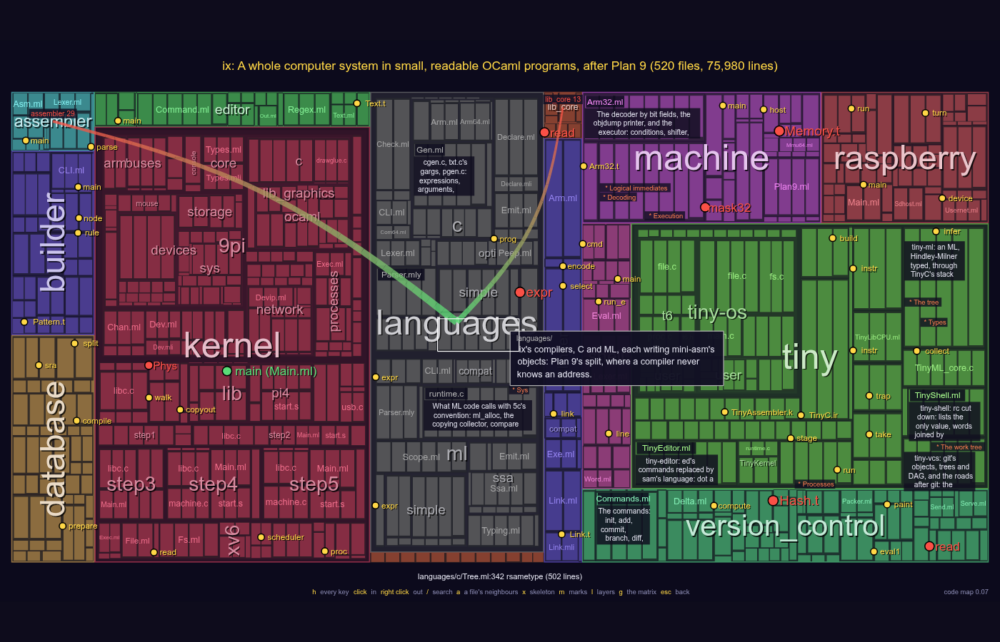
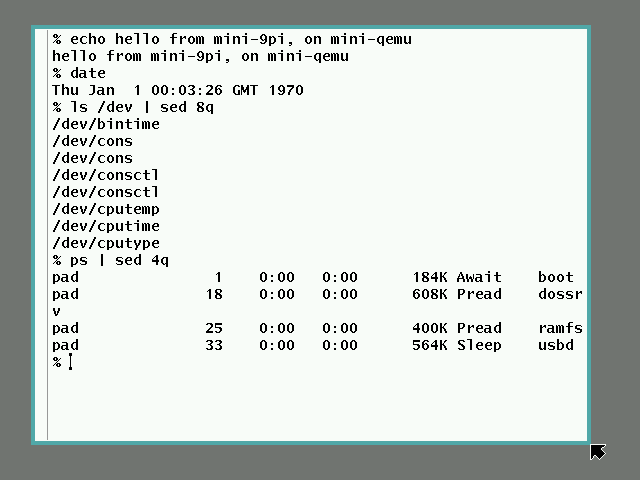
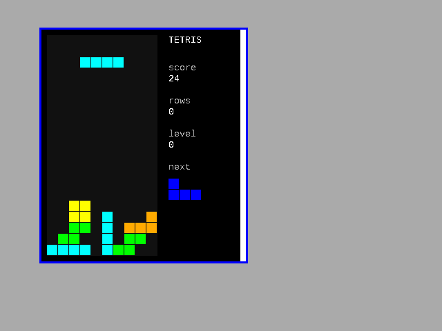

# 

**A whole computer system in small, readable OCaml programs: a kernel,
a shell, C and ML compilers, an assembler and a linker, an editor, a
windowing system, a web browser, a build system, a database, version
control, and more.** It boots on real hardware: the
[Raspberry Pi](https://www.raspberrypi.com/), a computer anyone can
afford, and on its own emulator.

Website: **[aryx.github.io/IX](https://aryx.github.io/IX/)**, with a
[code map](https://aryx.github.io/IX/codemap.html) of the whole
repository to explore in the browser ([below](#the-code-map)), and
the system itself [running in a page](#two-sizes-of-each-program-m-ix-and-t-ix).

IX is a way to learn how a computer system works, end to end, by
reading its code. Each part of the system is a separate program, and
each program is small enough to read in a few sittings. None of them
is a toy, though. The compiler makes real ARM binaries. The kernel
runs a real operating system's user programs, up to its windowing
system and the network, and it boots on a real Raspberry Pi. IX's
emulator runs the same binaries and the same kernel.

The system IX follows is **Plan 9**, the successor of Unix written at
Bell Labs by Unix's own authors. Plan 9 is small, clean, and complete:
it has its own kernel, compilers, shell (`rc`), build tool (`mk`),
editor and windowing system (`rio`). It is explained program by
program in [Principia Softwarica](https://principia-softwarica.org/), a
series of books I (Yoann Padioleau) wrote, and my
[xix](https://aryx.github.io/xix/) project ports those programs to
OCaml at full size. You don't need to know either to read IX. IX
takes the same programs and makes each of them as small as it can.

## The goal: code a person can understand

Teaching people is the main goal of IX, and the test it sets itself is
that one person can understand all of it, not only each program. Most
software fails that test: a kernel, a compiler or a browser of today
is millions of lines, and no single person understands it, its own
authors included.

Most of IX's code is written by an AI (see
[Who wrote it](#who-wrote-it)), but it starts from designs made by
people (Plan 9's, xv6's, xix's), and it is directed to write the
smallest and most readable code that does the job. That code is then meant to become
[literate programs](https://principia-softwarica.org/literate-programming.html), as in
Principia Softwarica: books of a reasonable size that explain all of
the code to a human reader.

That is the paradox of IX. The trend these days is to use AI to write
more and more code, faster than anyone can read it, until only the AI
can add a feature to the program. IX uses AI the other way: it
rewrites giant programs in far **less** code, until a whole system is
small enough for a person to understand again, and to extend, by hand
or by asking the AI, in a way that person can still follow.

**Smaller programs, bigger understanding.**

## Two sizes of each program: m-IX and t-IX

Each program in IX comes in two versions:

- **mini** (`mini-mk`, `mini-rc`, `mini-cc`, ...): a faithful
  reimplementation of the Plan 9 program, only smaller. It is named
  after the original and does the same thing: its output is the
  original's, byte for byte. The executables `mini-cc` and `mini-ld`
  make are the ones Plan 9's compiler and linker make. Together, the
  mini programs are **m-IX** (a nod to Knuth's MIX computer).
- **tiny** (`tiny-build`, `tiny-shell`, `tiny-cc`, ...): a free
  variant, in a file under [`tiny/`](tiny/) (the largest ones also
  have a directory of parts beside their file). It is named after
  what it does, not after the original. It keeps the idea of the
  original and redesigns the rest, now that compatibility no longer
  matters. Together, the tiny programs are **t-IX**.

For example, `mini-mk` reads real Plan 9 mkfiles and builds all of
xix from them, and all of Principia Softwarica's Plan 9, kernel
included. `tiny-build` is a build system in one file of about
670 lines. It keeps mk's rules and `%` patterns, and uses content
digests instead of timestamps. Reading the two side by side shows
what is essential to a build system and what is history.

m-IX's kernel, mini-9pi, boots from an SD card on a real Raspberry Pi
(a Pi 1 and a Pi 2 so far), under QEMU, and under mini-qemu, IX's own
Pi emulator. t-IX's kernel boots on tiny-machine, a machine of IX's
own design that is only a program. Both also run in your browser:
**[m-IX](https://aryx.github.io/IX/m-ix.html)** is mini-qemu compiled
to JavaScript, booting mini-9pi from its SD card (a first version,
slow), and **[t-IX](https://aryx.github.io/IX/t-ix.html)** is
tiny-machine compiled to JavaScript, booting tiny-kernel, its window
system and tetris. And most programs of both sizes also run natively
on Linux or macOS (the shell, the editors, the compilers, the browser,
the games...). A program talks to its system through a single
interface, which has an implementation for each system, so the same
source file builds a program for both.

## The code map

[IX's code map](https://aryx.github.io/IX/codemap.html) shows the
whole repository as a map, in the browser. Each folder is a region and
each file a block sized by its code, and when you zoom in, a block
shows the code itself. Every folder and file has a one-line summary.
The X-ray (`x`) shows each part's skeleton, a click on a name shows its
definition, and `h` lists the other keys.

[](https://aryx.github.io/IX/codemap.html)

A link can open it on any part of the code:
[a folder](https://aryx.github.io/IX/codemap.html?focus=version_control),
[a file](https://aryx.github.io/IX/codemap.html?focus=tiny/TinyShell.ml),
[a definition](https://aryx.github.io/IX/codemap.html?focus=version_control&def=diff);
the tables below link each program this way.

## m-IX: the mini programs

The line counts are all the lines of a program's files, OCaml, C and
assembly, comments and `.mli` files included, but not the tests nor
the header comments that tell each module's idea and history (`make
loc`, 2026-11-13). Each program's *map* link opens it
in the code map.

**The system**: the kernel, the shell and the tools, the compilers,
the windows, the browser, and the libraries under them.

| program | what it is | lines | Plan 9 original | code |
|---|---|---:|---|---|
| **mini-9pi** | Plan 9's kernel in OCaml, for the Pi 1 and Pi 4; runs Plan 9's own programs, up to `rio` and TCP | 19,600 | `9pi` | [`kernels/9pi/`](kernels/9pi/) ([map](https://aryx.github.io/IX/codemap.html?focus=kernels/9pi)) |
| **lib_core** | what all programs share: IX's library, mini-ml's stdlib and threads, the C library | 19,600 | `libc`, ocaml-light's stdlib | [`lib_core/`](lib_core/) ([map](https://aryx.github.io/IX/codemap.html?focus=lib_core)) |
| **mini-rc** | the shell | 1,900 | `rc` | [`shell/`](shell/) ([map](https://aryx.github.io/IX/codemap.html?focus=shell)) |
| **mini-mk** | the build system; builds all of xix and of Principia Softwarica's Plan 9 from their mkfiles | 2,000 | `mk` | [`builder/`](builder/) ([map](https://aryx.github.io/IX/codemap.html?focus=builder)) |
| **the utilities** | the command-line programs: mini-cat, mini-ls, mini-grep, mini-sed, mini-awk, mini-bc, mini-tar, ... | 8,100 | `cat`, `ls`, `grep`, `sed`, `awk`, `hoc`, `dc`, `bc`, `tar`, `gzip` | [`utilities/`](utilities/) ([map](https://aryx.github.io/IX/codemap.html?focus=utilities)) |
| **mini-cc** | the C compiler for arm and arm64; the same instructions as Plan 9's `5c` and `7c` | 5,100 | `5c`, `7c` | [`languages/c/`](languages/c/) ([map](https://aryx.github.io/IX/codemap.html?focus=languages/c)) |
| **mini-ml** | the OCaml compiler (IX's subset), for arm and arm64; compiles all of IX | 12,000 | ocaml-light's `ocamlopt` | [`languages/ml/`](languages/ml/) ([map](https://aryx.github.io/IX/codemap.html?focus=languages/ml)) |
| **mini-asm** | the assembler for arm and arm64 | 900 | `5a`, `7a` | [`assembler/`](assembler/) ([map](https://aryx.github.io/IX/codemap.html?focus=assembler)) |
| **mini-ld** | the linker, to Plan 9's a.out, Linux's ELF and macOS's Mach-O (arm64); the same executables as the original's, byte for byte | 3,000 | `5l`, `7l` | [`linker/`](linker/) ([map](https://aryx.github.io/IX/codemap.html?focus=linker)) |
| **lib_executable** | an executable read: ELF, DWARF, its symbols and stack frames, for the debugger, the profiler and the linker's tools | 800 | `libmach` | [`lib_executable/`](lib_executable/) ([map](https://aryx.github.io/IX/codemap.html?focus=lib_executable)) |
| **mini-lex**, **mini-yacc** | the lexer and parser generators (ocamllex's and ocamlyacc's languages) | 1,100 | `lex`, `yacc` | [`generators/`](generators/) ([map](https://aryx.github.io/IX/codemap.html?focus=generators)) |
| **mini-acid**, **mini-prof** | the debugger, by mini-9pi's `/proc` or Linux's `ptrace`; the profiler; mini-stats | 3,900 | `acid`, `prof`, `stats` | [`debuggers/`](debuggers/), [`profilers/`](profilers/) ([map](https://aryx.github.io/IX/codemap.html?focus=debuggers)) |
| **mini-git**, **mini-diff**, **mini-merge3** | version control, compatible with git repositories | 4,400 | `git9`, `diff` | [`version_control/`](version_control/) ([map](https://aryx.github.io/IX/codemap.html?focus=version_control)) |
| **mini-ed** | the line editor | 1,100 | `ed` | [`editors/ed/`](editors/ed/) ([map](https://aryx.github.io/IX/codemap.html?focus=editors/ed)) |
| **mini-emacs** | the screen editor, in a terminal, a window on Linux, or one of mini-rio's | 2,800 | efuns (the author's Emacs in OCaml) | [`editors/emacs/`](editors/emacs/) ([map](https://aryx.github.io/IX/codemap.html?focus=editors/emacs)) |
| **lib_graphics** | the graphics stack: images and their formats, fonts, the display, mouse and keyboard | 10,200 | `libdraw`, `libmemdraw`, `devdraw` | [`lib_graphics/`](lib_graphics/) ([map](https://aryx.github.io/IX/codemap.html?focus=lib_graphics)) |
| **mini-rio** | the windowing system, a file server giving each window its own `/dev/cons` and mouse; the desktop | 2,700 | `rio` | [`windows/`](windows/) ([map](https://aryx.github.io/IX/codemap.html?focus=windows)) |
| **lib_gui** | a GUI toolkit: widgets, themes, layouts, a text and its editing | 2,900 | `libpanel` | [`lib_gui/`](lib_gui/) ([map](https://aryx.github.io/IX/codemap.html?focus=lib_gui)) |
| **lib_networking** | 9P, TLS 1.3 and HTTP; mini-curl and mini-httpd | 6,300 | `lib9p`, `devip`, `webfs` | [`lib_networking/`](lib_networking/) ([map](https://aryx.github.io/IX/codemap.html?focus=lib_networking)), [`networking/`](networking/) |
| **lib_crypto** | SHA-1, and what TLS 1.3 stands on | 1,800 | `libsec` | [`lib_crypto/`](lib_crypto/) ([map](https://aryx.github.io/IX/codemap.html?focus=lib_crypto)) |
| **lib_compression** | zlib | 800 | `libflate` | [`lib_compression/`](lib_compression/) ([map](https://aryx.github.io/IX/codemap.html?focus=lib_compression)) |
| **mini-netscape** | a web browser: HTML, CSS, layout, a JavaScript engine; also mini-lynx, in a terminal, and mini-node, the JavaScript alone | 19,900 | Netscape Navigator; the author's mini-chrome | [`browsers/`](browsers/) ([map](https://aryx.github.io/IX/codemap.html?focus=browsers)) |
| **lib_audio** | a synthesizer, and the formats sounds and songs are kept in | 8,400 | the author's playground | [`lib_audio/`](lib_audio/) ([map](https://aryx.github.io/IX/codemap.html?focus=lib_audio)) |
| **lib_playground** | what the games are written on: Elm's Playground in OCaml (a picture, an animation, a game) | 12,400 | `games/4s` | [`lib_playground/`](lib_playground/) ([map](https://aryx.github.io/IX/codemap.html?focus=lib_playground)) |
| **mini-chidb** | a relational database: SQL, a query optimizer, B-trees | 2,600 | [chidb](https://github.com/uchicago-cs/chidb), SQLite's teaching twin | [`database/`](database/) ([map](https://aryx.github.io/IX/codemap.html?focus=database)) |
| **mini-troff**, **mini-man** | the typesetter: manual pages, papers, Markdown and simple LaTeX books, for a terminal and as PDF; IX's own manual pages | 5,900 | `troff -man -ms`, `tbl`, `pic`, `man`, `latex`, `noweave`, `bibtex` | [`typesetting/`](typesetting/) ([map](https://aryx.github.io/IX/codemap.html?focus=typesetting)) |
| **mini-5i** | an ARM emulator for user programs, arm32 and arm64, with Linux's or Plan 9's system calls | 4,800 | `5i` | [`machine/`](machine/) ([map](https://aryx.github.io/IX/codemap.html?focus=machine)) |
| **mini-qemu** | a Raspberry Pi 1 and Pi 4 emulator, which boots xv6, Plan 9 and IX's kernels | 4,800 | QEMU's raspi machines | [`raspberry/`](raspberry/) ([map](https://aryx.github.io/IX/codemap.html?focus=raspberry)) |

**Beyond the system**: the applications a developer, and anyone, use
every day, the games, and other languages and systems (most of them
not in Principia Softwarica).

| program | what it is | lines | original | code |
|---|---|---:|---|---|
| **mini-office** | an office suite on lib_gui: rich text, a sheet with its formulas, drawing and painting | 5,000 | the author's playground's TinyOffice | [`apps/office/`](apps/office/) ([map](https://aryx.github.io/IX/codemap.html?focus=apps/office)) |
| **mini-pim** | mail, calendar, people, tasks, notes and money, in one store where each item refers to the others | 10,200 | `upas`, `acme Mail` | [`apps/pim/`](apps/pim/) ([map](https://aryx.github.io/IX/codemap.html?focus=apps/pim)) |
| **mini-files**, **mini-page**, **mini-play**, **mini-maps**, **mini-rebirth** | a file manager; a PDF's pages or a picture; a sound file played; a map moved and zoomed; a music studio | 7,000 | `page`, `play` | [`apps/`](apps/) ([map](https://aryx.github.io/IX/codemap.html?focus=apps)) |
| **the games** | on lib_playground, Tetris, Breakout and others; and by renderers of their own, **Doom**, **Quake** and **Virtua Racing** | 22,800 | `games/` | [`games/`](games/) ([map](https://aryx.github.io/IX/codemap.html?focus=games)) |
| **the other languages** | mini-scheme, mini-smalltalk, mini-prolog, mini-datalog, mini-forth, mini-pascal, mini-tiger, and .NET's mini-dotnet and mini-csc; mini-drscheme and a Turbo Pascal | 41,500 | | [`languages/`](languages/) ([map](https://aryx.github.io/IX/codemap.html?focus=languages)) |
| **mini-analyze** | IX's code analysed in Datalog: dead code, exceptions that escape, capabilities, bugs | 4,600 | | [`analyzers/`](analyzers/) ([map](https://aryx.github.io/IX/codemap.html?focus=analyzers)) |
| **the other kernels** | mini-xv6, Oberon, Singularity, Squeak | 14,300 | xv6 | [`kernels/`](kernels/) ([map](https://aryx.github.io/IX/codemap.html?focus=kernels)) |

The system, m-IX, is made of the rows of the first table and two small
libraries (lib_code and lib_mime). It is **about 170,400 lines**, or
203,600 with the header comments. A system a person can read needs a
limit, set before the system is full, and m-IX's limit is 175,000 of
those lines: whatever is added has to fit, or something else is trimmed
first. Today m-IX is 4,600 lines under it, and
[docs/loc.md](docs/loc.md) logs the numbers and what moved them. The
programs beyond the system add about 105,300 lines, which are not
counted in the budget.

## t-IX: the tiny programs

Each program is a `.ml` file in [`tiny/`](tiny/), and the largest ones
also have a directory of parts beside their file. Each has an `.mli`,
which is where to start reading
([map](https://aryx.github.io/IX/codemap.html?focus=tiny)).
[tiny/README.md](tiny/README.md) has a table of the programs, says
what idea each one keeps from its original and what it redesigns, and
explains how a program is built for tiny-kernel and for the host.

| | programs | lines |
|---|---|---:|
| **the machine**, what the rest runs on | tiny-cpu, tiny-machine ([run it in your browser](https://aryx.github.io/IX/t-ix.html)) | 3,530 |
| **the kernel** | tiny-kernel: processes, files, graphics, sound, network | 5,720 |
| **the tools** | tiny-shell, tiny-editor, tiny-build, tiny-db, tiny-vcs, tiny-prof | 4,340 |
| **the toolchain**, with which tiny-kernel rebuilds its own image | tiny-cc, tiny-ml, tiny-as, tiny-ld | 6,390 |
| **the window system** and its programs | tiny-windows, tiny-tetris, tiny-calculator, tiny-office, tiny-troff, tiny-browser | 6,250 |
| **the libraries** under the programs | TinyLibCore (the standard library), TinyLibSystem, tiny-playground, tiny-gui...; the runtimes of C and ML | 7,460 |

Counting their `.mli` files, their C (tiny-cc's and tiny-ml's
runtimes, and tiny-kernel's programs written in C) and tiny-machine's
assembly, the tiny programs are **about 34,400 lines** without the
header comments (`make loc`, 2026-11-13). That is more than t-IX's
budget of 30,000.

## Build and run

```bash
./configure   # checks the tools, installs the opam packages (Linux, macOS)
make          # builds everything; the executables are then in bin/
make test
./bin/mini-mk -h            # every program has -h, with examples
./mini-pi mini-9pi          # boot mini-9pi on mini-qemu, with ix's own programs (mini-rc...)
./mini-pi mini-9pi-principia -g   # with principia's programs and SD card: type rio
./tiny-machine -window tiny-kernel   # tiny-kernel and its screen: type windows, then tetris in a window
```

`./configure` needs OCaml, opam and make. For any other tool that is
missing, it tells you what works without it. The other projects'
checkouts (`~/ocaml-light`, `~/principia`, `~/xv6`) are optional:
`./mini-pi mini-9pi` needs nothing but IX.

mini-9pi under mini-qemu, running Plan 9's own `rio`:



tiny-kernel on tiny-machine, Tetris in a window of tiny-windows:



The tests, from the quick ones to the whole suite
([docs/testing.md](docs/testing.md) says which one to run when):

```bash
make test           # = make test-lite
make test-lite      # before each commit, two minutes on all the cores: unit tests,
                    # mini-ml on IX, IX built by IX from nothing, kernels booted
make test-tix       # the same for t-IX alone (tiny/, tiny-kernel), about a minute
make test-mix       # and for m-IX alone
make test-all       # every test suite, one after the other, with a summary: half an
                    # hour (tests/all.sh -l lists them)
```

The plans, tutorials, manuals and related-work notes are indexed in
[docs/README.md](docs/README.md), and
[docs/projects.md](docs/projects.md) maps the projects inside IX: the
machines (real ARM, or our own) and what runs on each.

## Bootstrapping

IX builds itself. The first build needs a compiler from outside:
`make` uses dune, OCaml 4.14 and, under OCaml, gcc. After that first
build, IX's own tools are enough. mini-mk runs the mkfiles; mini-ml,
mini-lex and mini-yacc compile the OCaml code; mini-cc and mini-asm
compile the C library and mini-ml's runtime; and mini-ar and mini-ld
link. No OCaml compiler, gcc, GNU binutils or glibc is run or linked,
and the results are under `_mk/`.

```bash
make                   # stage 0: IX built by OCaml and dune (bin/)
make ix                # stage 1: IX built by stage 0's tools, for arm64 (make ix-arm: for arm)
make test-ix-fixpoint  # stage 2: IX built by stage 1's tools: the same files
make kernels-ix        # mini-xv6 and mini-9pi for the Pi 4, the same way
make test-ix           # each program of stage 1 against dune's build of it
```

Stage 2 is the fixed point: IX built by the programs that IX built
gives the same 383 files as stage 1, byte for byte. The kernels built
this way boot and pass the same checks as the ones built by
ocaml-light and gcc. Only mini-qemu, which opens its window with SDL,
and the tests are not built by IX. The plan and its history are in
[docs/plans/done/plan_mkfiles.md](docs/plans/done/plan_mkfiles.md) and
[docs/plans/done/plan_ml_bootstrap.md](docs/plans/done/plan_ml_bootstrap.md).
t-IX builds itself too, on tiny-kernel
([tiny/README.md](tiny/README.md#bootstrapping)).

## Tiny (and mini), not Toy

There is a good tradition of teaching computer systems by their code:
[Nand2Tetris](https://www.nand2tetris.org/)
([*The Elements of Computing Systems*](https://www.nand2tetris.org/book))
for the whole stack, [Minix](https://www.minix3.org/)
([*Operating Systems: Design and Implementation*](https://en.wikipedia.org/wiki/Operating_Systems:_Design_and_Implementation))
for an operating system, and [xv6](https://pdos.csail.mit.edu/6.828/xv6)
for a kernel. The Nand2Tetris route makes everything minimal: a made-up machine, a
made-up assembler, a made-up OS. IX aims for the full stack too, but
makes the *programs* tiny, not the things they deal with:

- **The machine is real ARM**, arm32 and arm64. mini-5i runs user
  programs; mini-qemu is a whole Raspberry Pi, so that real kernels,
  not just user programs, run on it. The emulator stops with
  "unimplemented instruction" on what it does not know, so it also
  checks that a binary stays inside what IX handles.
- **The binaries are real.** mini-cc, mini-asm and mini-ld make them as
  Plan 9's compilers do, in three formats: ELF for Linux (arm and
  arm64), Mach-O for macOS (arm64, to sign with `codesign`), and
  Plan 9's a.out. So you can use the toolchain for programs on your
  own machine, as with [goken](https://github.com/aryx/goken9cc). The
  same binary runs on IX's emulator, on
  QEMU and on a real ARM machine. Running it on several and comparing
  the results is the main test.
- **The system calls are real.** User programs talk to the kernel
  with Plan 9's system call ABI, and mini-9pi runs Plan 9's own user
  programs, unmodified, from Plan 9's own SD card image.
- **The kernel is a real binary.** Unlike Nachos, where the "OS" is
  ordinary code running on the host, mini-9pi is an ARM binary: a thin
  layer of C and assembly boots the machine and starts a small OCaml
  runtime, and the kernel is OCaml from there on. Processes, address
  spaces, context switches, user mode and the system call boundary are
  therefore real.

  ```
   user program (a.out)                          user mode
   ----------------- SWI / trap / irq -----------------------
   mini-9pi (OCaml + thin C/asm runtime shim)     supervisor mode
   ---------------------------------------------------------------
   ARM CPU + CP15 (MMU, modes): a real Raspberry Pi, or
   mini-qemu emulating one, with disk, timer, framebuffer,
   keyboard, mouse and network
  ```

One group of tiny programs takes the other road on purpose. tiny-cpu
and tiny-machine are a made-up machine, as Knuth's MIX and
[MMIX](https://www-cs-faculty.stanford.edu/~knuth/mmix.html)
([*MMIXware: A RISC Computer for the Third Millennium*](https://www-cs-faculty.stanford.edu/~knuth/mmixware.html))
and Nand2Tetris's Hack are, because what they teach is the design of an
instruction set: the choices a real one made for history's reasons,
made again with hindsight. tiny-cpu stands next to mini-5i, the
same program for real ARM, so that the two roads can be compared.

## Who wrote it

IX is mostly written by Claude (Anthropic's AI, in Claude Code), under
my direction: I choose the design and review the code, and Claude
writes most of the lines, for people to read
([the goal](#the-goal-code-a-person-can-understand)). xix, on the other hand, I mostly wrote
myself. Putting each mini program next to its xix twin makes a fair
comparison of the two ways of working. The project started on
2026-09-21; [docs/history.md](docs/history.md) tells how.

[docs/yoann_notes/prompt-history.md](docs/yoann_notes/prompt-history.md)
has every prompt I wrote to Claude to build IX, in order and verbatim,
each with a short summary of Claude's answer. Read next to `git log`,
it shows what directing an AI to write a codebase looks like day to
day.

## The name

IX is 9 in roman numerals (Plan 9), and ix is xix with a letter
removed: a smaller xix. It is also the "-ix" of Unix, Minix and Linux
with nothing in front, and it has two letters, like `rc`, `mk`, `ed`,
and "ai", which writes most of it.

## License

LGPL 2.1 with the OCaml-style linking exception, like
[xix](https://aryx.github.io/xix/): see [license.txt](license.txt) and
[copyright.txt](copyright.txt).
