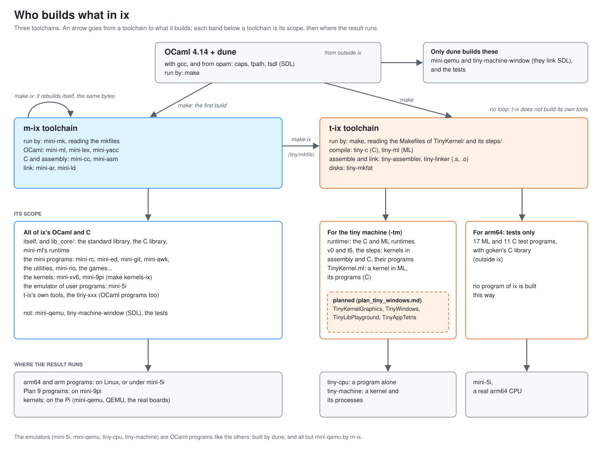

# t-ix: a programmer's manual

t-ix is the tiny half of ix (`tiny/`): a machine of our own design,
its assembler, a C and an ML compiler for it, and kernels that run on
it. This manual is the reference for someone writing a program or a
kernel for that machine: its registers, its devices and their
addresses, how a program is built and where it is loaded. It gathers what the
programs' headers say (`TinyMachineCPU.ml`'s, `TinyMachine.ml`'s,
`TinyKernel.ml`'s): they are the first source, and where this manual
and a header differ, the header is right. Each
program's header says how it works and why
([`tiny/README.md`](../../tiny/README.md) lists them); the plans say
how each was decided ([plan_tiny_os.md](../plans/plan_tiny_os.md),
[plan_tiny_windows.md](../plans/done/plan_tiny_windows.md),
[notes_tiny_kernel.md](../notes/notes_tiny_kernel.md)).

The other tiny programs (tiny-shell, tiny-utils, tiny-editor,
tiny-prof, tiny-db, tiny-vcs, tiny-build) run both on the host and on
tiny-kernel: the same file is built by OCaml for one and by tiny-ml
for the other, where they are `rc`, the utilities, `ed`, `prof`, `db`,
`vcs` and `build` in its `/bin`. This manual does not cover them
beyond that. The toolchain runs on tiny-kernel too, as `cc`, `ml`,
`as` and `ld`, and each tool makes the same files as the host's, byte
for byte
([plan_tiny_self_hosting.md](../plans/done/plan_tiny_self_hosting.md),
step 7). Only tiny-cpu stays on the host.

## 1. The quick way

    ./tiny-machine tiny-kernel    # TinyKernel.ml, a kernel in ML: a shell on the console
    ./tiny-machine -window tiny-kernel    # and its screen in a window: paint draws there
    ./tiny-machine t6             # t6, a step before it: a kernel in C, with its disk
    ./tiny-machine v0             # v0, the first step: a page of assembly and four programs
    ./tiny-machine kernel.s a.s # a kernel of yours, and its programs

`-l` prints the kernel's listing instead of running it, `-n` skips the
build, `-w` keeps t6's writes to its disk. Ctrl-D ends the
shell and the machine, Ctrl-\ quits at once, Ctrl-C goes to the kernel.

The script builds the tools with dune and calls them. To do the same
by hand, use these tools:

| tool | what it does |
|---|---|
| `tiny-cc f.c` | C to an object, `f.o` (`-S`: its assembly instead) |
| `tiny-ml f.ml` | ML to an object, `f.o` (`-S`: its assembly instead) |
| `tiny-as f.s` | assembly written by hand to an object, `f.o` (`tiny/TinyAssembler.ml`; `tiny/TinyLibMachine.mli` has the object's format) |
| `tiny-ld [-a n] [-map] -o out f.o...` | objects to an image, the first at 0 (`-a n`: an a.out for tiny-kernel that asks for n MB; `-map`: `out.map`, each label's address) |
| `tiny-ar -o lib.a f.o...` | objects kept in one file, a library, in their order (`tiny/TinyArchiver.ml`); tiny-ld links all its members, as if each were given; `-t lib.a` lists them |
| `tiny-cpu image` | runs a program alone, the host answering its three system calls |
| `tiny-machine image` | the same with the machine around the CPU: the image is a kernel's |
| `tiny-mkfs [-m n] disk.img name=file...` | a disk of tiny-kernel's file system, made on the host by the kernel's own `KFS.ml` (`tiny/TinyKernel/host/TinyMkfs.ml`; `-l disk.img` lists it) |
| `tiny-mkfat` | t6's disk image (`tiny/TinyKernel/steps/t6/TinyMkfat.ml`) |
| `tiny-prof p -k k.map -u p.map` | where the instructions went, by function, from a profile written by `tiny-cpu -prof p` or `tiny-machine -prof p` and the maps of the links (`tiny/TinyProfiler.ml`; its `.mli` shows how it found what made `www`'s scrolling slow) |

`tiny-cpu -h` and `tiny-machine -h` show each option on an example.

tiny-kernel's graphical programs also run on the host, in a window of
their own, with no machine: `tiny-office file`, `tiny-www OCaml`,
`tiny-emacs file`, `tiny-calc`, `tiny-tetris`; and `tiny-troff [-h |
-p] file` prints a document (§7.10).

## 2. How t-ix is put together



The picture shows all of ix; t-ix is its right half. The rest of this
section describes that half in words.

### 2.1 Two worlds

A tiny program runs either on the host or on the tiny machine.

    the host (OCaml, built by dune or by ix's own tools)
      tiny-cc, tiny-ml         compilers: C and ML to objects (-S: assembly)
      tiny-cpu, tiny-machine   the assembler, the linker and the machine
      tiny-mkfat               disk images
      tiny-machine-window      the screen in a window (SDL)
            |
            |  .s files, linked to an image
            v
    the tiny machine (assembly, C and ML, built by the programs above)
      runtime/              the C runtime
      TinyKernel/              a kernel in ML (TinyKernel.ml), and its programs
      TinyKernel/steps/v0, t6  the steps before it, in assembly and C
      runtime/ml/ml.c            the ML runtime, in C

`TinyKernel/` is in `tiny/` beside the host's programs but is not
one of them: OCaml never compiles `TinyKernel.ml`, tiny-ml does.

### 2.2 What a host program needs outside `tiny/`

Each host program is one file, or a file plus its parts in a folder
of the same name (`TinyC/`, `TinyML/`, `TinyMachine/`, `TinyBrowser/`,
`TinyOffice/`), but not all of them stand alone. This table says what
each needs from outside `tiny/`, according to `tiny/dune` (and to
`tiny/TinyKernel/steps/t6/dune` for tiny-mkfat):

| program | outside `tiny/` |
|---|---|
| tiny-cpu, tiny-mkfat | `lib_core/`, `fpath`, `caps` |
| tiny-machine, tiny-shell, tiny-utils, tiny-editor, tiny-prof, tiny-db, tiny-cc, tiny-ml, tiny-as, tiny-ld | `lib_core/`, `fpath`, `caps`, `unix` (the tools through the host's `TinyLibSystem`, `TinyLibSystem/unix/`) |
| tiny-vcs, tiny-build | the same, and `lib_crypto/` (SHA-1; TinyLibCore's `Sha1` under tiny-ml) |
| tiny-machine-window | SDL by `tsdl` (`TinyMachine/TinyMachineSDL.ml`; mini-qemu has its own, `raspberry/video/Sdl_display.ml`) |
| tiny-machine-fetch | `lib_networking/` (DNS, TLS 1.3, HTTP), `lib_graphics/images/` (PNG, JPEG, GIF), `lib_compression/`, `lib_crypto/` |

Inside `tiny/`, two libraries are shared. tiny-cpu and tiny-machine
share `TinyMachineCPU.ml`. `TinyMachineDevices.ml` is tiny-machine's
machine without a host, and two programs share it: the terminal's,
`TinyMachine.ml`, and a web page's, `TinyMachineWeb.ml`. The web
page's is built only by OCaml and js_of_ocaml;
`./tiny-machine -web dir tiny-kernel` makes the page's directory.

What they take from `lib_core/` is its `commons/`: `FS` (to read or
write a file whole), `Console` (for printing) and `Procs` (for
children and pipes). `caps` gives the capabilities that each `main`
takes (`Cap.stdin`, `Cap.open_in`...), and `fpath` gives the paths.

### 2.3 Two ways to build the host's programs

- **By dune** (`make`, or `dune build`): OCaml 4.14 with its standard
  library, and `caps`, `fpath` and `tsdl` from opam. The executables
  are `_build/default/tiny/TinyXxx.exe`, installed as `tiny-xxx`.
- **By ix's own tools** (`tiny/mkfile`, read by mini-mk): mini-ml
  compiles each file and mini-ld links it, with ix's standard library
  (`lib_core/`, where `Cap`, `Fpath` and `Unix` are ix's own). No C
  library is linked. All the programs of 2.2 are built this way,
  except tiny-machine-window.

So a tiny program is written in what both accept. ix's library is
the smaller of the two: it has no `Scanf`, for example, and its
`Option.value` takes no label.

### 2.4 How the tiny machine's programs are built

They are built by Makefiles that call the host's tools, found in the
`PATH` or in ix's `bin/`:

| Makefile | what it builds |
|---|---|
| `tiny/TinyKernel/steps/Makefile` | `libc.s` (from `tiny/runtime/`), `hello`, then each step |
| `tiny/TinyKernel/steps/t6/` | `kernel.img`, the user programs, `fs.img` (tiny-mkfat) |
| `tiny/TinyKernel/Makefile` | `kernel.img`, the user programs, `boot.img`, the disks |

Each Makefile writes what it builds in a `_make/` inside its own
directory, and nowhere else, as dune does with `_build/` and mini-mk
with `_mk/`. So the directories show only the sources, and
`make clean` removes `_make/`.

There are always the same two steps. First the objects are made:
tiny-cc or tiny-ml compiles the sources, and tiny-as assembles the
assembly written by hand (kentry.s, the runtime's start.s...). Then
tiny-ld links the objects:

    tiny-cc x.c                 # x.o; or tiny-ml, for ML
    tiny-as start.s             # start.o: assembly written by hand
    tiny-ld -o kernel.img kentry.o ... x.o                  # a kernel: linked at 0
    tiny-ld -o prog start.o udivmod.o libc.o prog.o        # a program

`boot.img` is `kernel.img` followed by its files, which the kernel
reads at its start; each file is a name, a size and its bytes. The
files are the few programs that mend a disk (`sh`, `rc`, the
utilities, `ed`), seen as `/boot` when there is a disk, and `memory`,
the kernel's way of giving memory (`MEMORY=segments`). The system is
on the first disk, `disk.img` (`/bin`, `/lib`, `/examples`, and what
`build install` put there), and the sources are on the second,
`src.img` (`/src`). `tiny-mkfs` makes each disk, just as m-ix's
machine has its `boot.img` and its `card.img`. In the image, a line
`link utils` in place of the size makes a hard link instead, as the
`link` call does: the name is given the same file as `utils`, with no
bytes of its own. That is how one program, `utils`
(`tiny/TinyUtilities.ml`, compiled by tiny-ml), is `cat`, `ls`, `wc`
and the 24 other utilities. On the disk, `ln` made them, and at the
prompt `ln` makes one the same way.

### 2.5 What runs what

    ./tiny-machine tiny-kernel
      -> dune builds the host's tools
      -> make -C tiny/TinyKernel                (tiny-ml, tiny-cc, tiny-as, tiny-ld)
      -> tiny-machine tiny/TinyKernel/_make/boot.img
           the kernel at 0, in supervisor mode
           -> /bin/sh in a partition, in user mode
                -> the programs it runs, each a process

## 3. The CPU (`TinyMachineCPU.ml`)

- **16 registers of 32 bits**, `r0` to `r15`. `r0` is always 0. By
  convention `sp` is `r14` and `lr` is `r15`.
- **No flags.** A branch compares two registers; `slt` turns a
  comparison into a value.
- **One format**: each instruction is 4 bytes, with an 8-bit opcode,
  two 4-bit registers `d` and `a`, and a 16-bit immediate whose low 4
  bits name the third register.

| instructions | meaning |
|---|---|
| `add sub mul div rem and or xor shl shr sar slt sltu` | `d = a op b` |
| `addi andi ori xori shli shri sari slti sltiu` | `d = a op imm` |
| `lui` | `d = imm << 16` |
| `ldw ldb stw stb` | `d, imm(a)`: a word or a byte loaded or stored |
| `beq bne blt bge bltu bgeu` | `d, a, label` |
| `jal jalr` | a jump, `d = pc + 4` |
| `sys n` | a system call, its number `n` |

The assembler adds `li`, `la`, `mov`, `call`, `ret`, `j` and `nop`,
and the directives `.word`, `.byte`, `.ascii`, `.asciz`, `.space` and
`.align`. A comment starts with `;`.

Every case is defined: a division by 0 gives -1, a shift takes its
amount modulo 32, an address is taken modulo the memory's size, and a
word's two low address bits are ignored.

**Why `-16(r0)` is a device.** Since `r0` is 0 and addresses wrap, a
negative offset from `r0` is an address counted down from the top of
memory. The devices are there (section 5), so any instruction reaches
one without setting up a register: `stb r3, -16(r0)` prints a byte.

## 4. The machine (`TinyMachine.ml`)

The machine is the CPU plus what a kernel needs. It has 256 MB of
memory (16 MB until 2026-10-15, 128 MB until 2026-10-23). It starts
at address 0 in supervisor mode, with `sp` just below the devices.
With `tiny-machine -cores n` it has n cores that share the memory;
each has its own registers, its pc and its registers of control.
Every core starts at 0, and a kernel tells them apart by the register
`core` (4.2). The cores signal each other by an interrupt (4.3, and
`-64(r0)` in section 5).

### 4.1 Modes and traps

There are two modes, supervisor and user. There is one way into
supervisor mode, a trap: it saves the pc in `epc`, the reason in
`cause` and a detail in `tval`, enters supervisor mode with
interrupts off, and jumps to `tvec`. There is one way out: `eret`.

| `cause` | reason | `tval` | `epc` |
|---:|---|---|---|
| 1 | `sys n` | `n` | after the `sys` |
| 2 | an illegal instruction | the word | on it |
| 3 | a fault (an address not allowed) | the address | on the instruction |
| 4 | an interrupt | its sources, a bit each | on the instruction not yet run |

### 4.2 The registers of control

A register of control is read by `csrr d, name`, written by
`csrw name, a`, and both at once by `csrrw d, name, a`. These three
instructions, `eret` and `wfi` are illegal in user mode.

`wfi` waits for an interrupt: the core sleeps from the next
instruction until a source enabled in `ie` is pending, then goes on
(taking the interrupt when `status` has interrupts on). An idle
kernel's loop is `wfi` then a jump back to it; the machine then
counts the time asleep without running anything, so a host holding
the machine to 20 million instructions a second spends nothing on it.
This is ARM's and RISC-V's `wfi`, and x86's `hlt`.

| name | what |
|---|---|
| `status` | bit 1 supervisor mode, 2 interrupts on, 4 and 8 those two as they were before the trap, 16 the window relocates |
| `epc`, `cause`, `tval`, `tvec` | the trap's (above) |
| `time` | the instructions run so far (read only) |
| `timecmp` | the timer interrupts when `time` reaches it |
| `base`, `bound` | the window (4.4) |
| `satp` | the pages' root; its top bit turns pages on (4.4) |
| `ip`, `ie` | the interrupts pending (read only) and enabled, a bit a source |
| `core` | the core's number, 0 to `cores` - 1 (read only) |
| `cores` | the number of cores (read only) |
| `scratch` | a word for the kernel |
| `rate` | the machine's speed, in instructions per second (read only) |

The time is the count of instructions, not the host's clock, so the
same image with the same input runs the same every time. The `rate`
register says how many of those instructions make a second: 8 million
by default, or what `tiny-machine -rate n` asks for. A kernel reads it
to turn instructions into seconds.

There is one more instruction, legal in both modes:
`amoswap d, a, (b)` swaps the word at the address in `b` with `a` in
one step, for a lock.

### 4.3 Interrupts

An interrupt is taken when `status` has interrupts on and a source is
both pending and enabled. `tval` then holds the sources.

| bit | source | pending until |
|---:|---|---|
| 1 | the timer | `timecmp` is moved past `time` |
| 2 | the console's input | its bytes are read |
| 4 | the disk | its status word is written |
| 8 | the mouse | its word is read |
| 16 | the network | its packet is taken |
| 32 | another core | `-64(r0)` is read |

Only the timer is enabled at the start.

### 4.4 Protection: a window, or pages

In user mode, with pages off, an address must be inside the window.

- **Plain** (v0): `base <= address < bound`. A program is assembled
  where it runs.
- **Relocating** (`status` bit 16; t6, TinyKernel.ml): the address
  must be below `bound`, and `base` is added to it. Every program is
  assembled at 0.

When `satp`'s top bit is set, addresses go through two-level page
tables instead, as in RISC-V's Sv32: 10 bits index the root table, 10
the next table, and 12 a 4 KB page. No kernel of ix sets it since v6
was removed, but `tiny/tests/TinyMachine_tests/paging.s` does. An
entry's flag bits are 1 valid, 2 read, 4 write, 8 execute and 16
user. Supervisor mode reaches every
valid page.

## 5. The devices

The devices are sixteen words at the top of memory, outside any
window, so only a kernel reaches them. Only core 0 reaches them,
except the first, `-64(r0)`, which every core reaches.

| address | | device |
|---|---|---|
| `-64(r0)` | `0xfffffc0` | the interrupt between cores: k stored raises core k's; read, the cores that raised this one's, a bit each (1 for core 0, 2 for core 1...), cleared |
| `-60(r0)` | `0xfffffc4` | a seed, read: the programs' first random number (tiny-machine's `-seed`; 0, none, the kernel giving its clock) |
| `-56(r0)` | `0xfffffc8` | the date at the boot, read: seconds since 2000-01-01 (the host's clock, or tiny-machine's `-date`) |
| `-52(r0)` | `0xfffffcc` | the speaker (5.6): written, its ring's address (0 off); read, the samples played |
| `-48(r0)` | `0xfffffd0` | the network (5.5): a memory address |
| `-44(r0)` | `0xfffffd4` | the network: a length; read, the length of the packet that waits, 0 if none |
| `-40(r0)` | `0xfffffd8` | the network: the command, 1 send, 2 receive |
| `-36(r0)` | `0xfffffdc` | the network: reads 1 when there is a wire |
| `-32(r0)` | `0xfffffe0` | the disk: a block's number |
| `-28(r0)` | `0xfffffe4` | the disk: a memory address |
| `-24(r0)` | `0xfffffe8` | the disk: the command, 1 read the block into memory, 2 write it from memory |
| `-20(r0)` | `0xfffffec` | the disk: reads 1 when a transfer is done; a write ends its interrupt |
| `-16(r0)` | `0xffffff0` | the console's output: a byte stored is printed |
| `-12(r0)` | `0xffffff4` | the halt: the value stored is the machine's exit status |
| `-8(r0)` | `0xffffff8` | the console's input: the next byte; `0xffffffff` none yet, `0xfffffffe` the input's end |
| `-4(r0)` | `0xffffffc` | the mouse (5.2) |

The disk is a file given by `-d`, in blocks of 1 KB. A transfer is
done at once, and the file is written back when the machine halts.

### 5.1 The screen

The screen is 1024 by 768 pixels, one byte each, stored row after
row from `0xf00000`. It
is memory like any other: `stb` stores a pixel, and a kernel that has
no use for a screen may use that megabyte as memory.

A byte is a colour in Plan 9's table of 256 (its `m8` pixels): 0 is
black, 255 white, `0xf0` red, `0x36` blue, `0xaa` a grey.

    tiny-machine -window kernel.img          # the screen in a window of the host's
    tiny-machine -screen out.ppm kernel.img  # the screen written at the halt, a PPM

### 5.2 The mouse and the keys

The mouse is one word: x in bits 0 to 11, y in bits 12 to 23, the
buttons from bit 24 (1 left, 2 middle, 4 right). Its interrupt is
pending from a change until the word is read.

The keys have no register of their own: they are the console's input,
`-8(r0)`. Without a window they come from the terminal or a pipe.
With `-window` they are typed in the window; the arrows are the bytes
128 to 131 (up, down, left, right).

### 5.3 A session replayed: `-events`

    tiny-machine -events session.txt -screen out.ppm kernel.img

The mouse and the keys come from a file with one event a line, each
with the time (in instructions) at which it happens:

    2000000 m 50 50 0        the mouse at 50, 50, no button
    2100000 m 300 150 1      there, the left button down
    2300000 k ls\n           these keys typed

In a `k` line, `\n` is a new line and `\` with three digits a byte
(`\003`). The input ends after the last event. As the time is the
count of instructions, the screen at the halt is the same on every
run: this is how a program with a mouse is tested
(`tiny/tests/TinyMachine_tests/screen.s`).

### 5.4 The window is another program

`tiny-machine -window` runs `tiny-machine-window`
(`TinyMachineWindow.ml`) as a child. It sends the child the screen,
as a PPM each time it changed, about thirty times a second, and reads
back event lines: those of section 5.3, without their times. A step
of the mouse's wheel (or of two fingers on a trackpad) comes as an
arrow key, up or down. When a program changes the mouse's look (it
writes the mouse's word: 0 the arrow, 1 a hand, as `www` does over a
link), tiny-machine sends the line `C n` between two pictures.
tiny-machine itself links no C library, so ix's own tools build it;
the window is the one tiny program that needs SDL, which it uses
through `TinyMachineSDL.ml`.

### 5.5 The network

The network is a wire with two ends, and the machine is at one of
them ([plan_tiny_network.md](../plans/done/plan_tiny_network.md)).
tiny-kernel uses it, with `ping`, `get`, and `dial` among its calls.
A packet is at most 2,048 bytes.

- **To send**: the packet's address at `-48(r0)`, its length at
  `-44(r0)`, then 1 at `-40(r0)`.
- **To receive**: the network's interrupt (source 16) is pending
  while a packet waits; `-44(r0)` reads its length. Write a buffer's
  address and size as for a send, then 2 at `-40(r0)`: the packet is
  copied (no more than the size) and the next one waits.
- At most 64 packets wait; one more is lost.

What is at the other end is the host's choice:

    tiny-machine -net dir kernel.img         # tiny-machine itself, at 10.0.0.1 (the machine is 10.0.0.2)
    tiny-machine -net dir -net-trace kernel.img   # and each packet said on the standard error
    tiny-machine -net dir -net-lose 3 kernel.img  # and its third packet is lost
    tiny-machine -net dir -net-pcap f kernel.img  # and the packets written in f at the halt (tcpdump -r f, Wireshark)
    tiny-machine -net dir -net-out kernel.img     # and it is the way to other machines
    tiny-machine -net dir -net-forward 8080:80 kernel.img   # and the host's port 8080 is the machine's port 80
    tiny-machine -net-loop 100 kernel.img    # the wire itself: each packet sent comes back 100 instructions later

With `-net` the other end is `KNetwork.ml`, the file that tiny-kernel
has for its own stack, run by the host (`TinyMachinePeer.ml`). A
packet from this peer lands 5 ms of the machine's time (40,000
instructions at 8 million a second) after it was sent. The peer
answers a ping. On port 70, over IL, it reads a line holding a name,
sends `dir`'s file of that name (no path) in messages of 1,024 bytes,
then closes; that is `get hello.txt` in tiny-kernel, with
`tiny/tests/www` as `dir`. The other way, `put file [name]` sends a
line `put name size` and then the file's bytes; the peer writes them
into `dir` and answers `ok`. tiny-kernel's files are in its memory and
go away with the machine, but what is put stays. An empty line
(`get ''`, Gopher's menu) lists `dir`, so a new boot brings it all
back with ``for(f in `{get ''}) get $f > $f``. The web page keeps what
is put in the browser's `localStorage`. A line of the trace has the
machine's time, the direction (`>` from the machine, `<` to it, `x` to
it and lost) and the packet:

        856.2 ms  > echo? 1, 4 bytes, from 10.0.0.2 to 10.0.0.1
        856.2 ms  < echo! 1, 4 bytes, from 10.0.0.1 to 10.0.0.2

A line that starts with `www` asks for a web page, for tiny-kernel's
browser (`docs/plans/done/plan_tiny_browser.md`). The other end sends the
page's bytes as the site sent them, then closes. The rest of the line
is an address. A bare title such as `OCaml` or `Plan 9 from Bell Labs`
names an English Wikipedia article, and an article's address is
changed to its REST HTML, the article without the site's menus
(`TinyMachinePeer.www_address`). With `-net-out` the page is fetched
by `tiny-machine-fetch` (`TinyMachineFetch.ml`), a separate program
that links ix's own TLS and HTTP, just as `tiny-machine-socket` is the
one that links the sockets. Without `-net-out`, or when the fetch
fails, a kept copy of a Wikipedia article in `dir` answers
(`tiny/tests/www/OCaml.html`); if there is none, the answer is one
line that starts with `www:` and says why. In tiny-kernel, running
`rc` and then `get 'www OCaml' | wc` shows the page's 257,035 bytes.

A line `img w h address` asks for a picture of a page. The answer is
a line `0 w h`, then one row of pixels a message, which www paints as
it arrives. `tiny-machine-fetch -picture` decodes the picture and
makes it w by h in the screen's colours; it takes the picture from
the address with `-net-out`, or else from a kept copy in `dir` named
by the address's last part.

**On Linux**, the machine can reach programs that are not ours,
without being root. With `-net-out` the other end is a gateway: when
tiny-kernel asks for a connection to any other address, the host
makes it over TCP, and the messages pass both ways. A message to the
world is sent as its bytes; the bytes from the world are cut into
messages wherever they happened to arrive. The gateway's port 53
answers a name with its address, so a host may be given by name:
`get / gopher.floodgap.com` is Gopher, and `get / example.com 80` is
the web as it was in 1996 (no https). With `-net-forward 8080:80` a
connection to the host's port 8080 goes to the machine's port 80. Run
`httpd` in tiny-kernel, then open `http://localhost:8080/` in a
browser: the page lists tiny-kernel's files, each as a link, and a
directory's link leads to its own page (`/bin/`, `/dev/`,
`/examples/`). The host's sockets are in a separate program,
`tiny-machine-socket` (`TinyMachineSocket.ml`), run once for each
connection with two pipes, as the window is; tiny-machine itself has
no sockets. `./tiny-machine tiny-kernel` gives all three options,
`-net`, `-net-out` and `-net-forward 8080:80`.

In the web page (`TinyMachineWeb.ml`) the other end is the same, but
its documents are the page's. A name is a file of `www/` beside the
image, and `wiki words` asks Wikipedia: it makes a search and gets the
first article's sentences and its picture, which the browser reads and
the page reduces to the screen's colours. `www` fetches the page
itself (Wikipedia allows it; a site that does not allow other pages to
fetch it cannot be reached from the page), or else a kept copy beside
the page. The wire is drawn under the console, one dot a packet, and a
button loses the next packet. `./tiny-machine tiny-kernel` in a
terminal gives the machine its wire with `tiny/tests/www`.

For an IL packet, a line of the trace has its kind, its number, the
last number its sender received, and its message's length
(`KNetwork.mli` shows a conversation with a packet lost):

       1325.4 ms  < data id 5001 ack 1001, 1024 bytes, from 10.0.0.1 to 10.0.0.2

A packet arrives at a time counted in instructions, so a run with
the network is the same every time
(`tiny/tests/TinyMachine_tests/net.s`). Without a wire `-36(r0)`
reads 0, a send is lost and nothing arrives.

### 5.6 The speaker

The speaker is memory, as the screen is
([plan_tiny_audio.md](../plans/done/plan_tiny_audio.md)): a ring of
8,192 samples, one signed byte each (0 is silence). The ring is
wherever the kernel says, by writing its address at `-52(r0)`. From
then on the speaker plays the ring, 8,000 samples a second of the
machine's time (one every `rate` / 8,000 instructions), and sets each
sample it played back to 0, so a ring that nobody writes is silent
instead of playing the last second over and over. When read,
`-52(r0)` gives the number of samples played since the ring was
given, modulo 2^30; the kernel writes ahead of that place. The
speaker has no interrupt: a kernel fills the ring up to a second
ahead, and looks again at its clock's ticks.

The samples due are played when somebody looks, either the kernel by
reading the word or the host by taking them, so the speaker costs no
instruction of its own and a run is the same every time:

    tiny-machine -audio a.wav kernel.img     # the samples as a WAV (8 bits, 8,000 Hz), at the halt,
                                             # from the first sound to the last
    tiny-machine -window kernel.img          # the window plays them

The window gets them as a line `A n` followed by `n` bytes, about
thirty times a second, and gives them to SDL's queue. When the queue
ran empty, it first queues a tenth of a second of silence, a margin
for the host's late frames; what comes while more than half a second
is queued is dropped. The web page has no sound yet.

## 6. Programs

### 6.1 The link, and an image

Each `.s` file is assembled alone, to an object that holds its words,
its labels, and the places where a label's address goes (`reloc`
lines, `tiny/TinyAssembler.mli`). tiny-ld puts the objects one after
the other, with their labels in one namespace and the first object at
address 0, where the machine starts, and fills in the places. The
image is the memory's first bytes, with no header.

### 6.2 C: `tiny-cc`

The arguments are on the stack, at `0(sp)`, `4(sp)` and so on; the
result is in `r13`; the callee may change any register but `sp`.

A program is linked after its runtime (`tiny/runtime/`):

    tiny-cc prog.c; tiny-cc libc.c
    for f in start udivmod; do tiny-as $f.s; done
    tiny-ld -o prog start.o udivmod.o libc.o prog.o
    tiny-cpu ./prog one two

`start.s` calls `main` and exits with its result. `libc.h` declares
`write`, `exits`, `print`, `sprint`, `malloc`, `free`, `strlen`,
`strcpy`, `strcmp`, `memset` and `atoi`.

### 6.3 ML: `tiny-ml`

A file is a module, compiled alone or with the others. Its names are
`M.x` in the modules after it, or `x` after `open M`; its types and
constructors belong to the whole program, in one name space.
Integers are 31 bits (a value is `2n+1` or a pointer), so a constant
beyond them is refused. The runtime is `runtime/ml/ml.c`, compiled by
`tiny-cc`, with a `main` that gives it its memory. A C or assembly function is called as an `external`,
with C's convention and ML's values. The standard library, the
modules of `TinyLibCore/`, is compiled once (`tiny-ml -c -L .`, each
module after the ones it names). tiny-ml reads its interfaces from
`/lib/ml` (`-L` gives another directory), and a program is linked
with its objects, which are kept in one library, `stdlib.a` (made by
tiny-ar).

    tiny-ml -c a.ml             # a.o, and a.tmi, its interface
    tiny-ml -c -I . b.ml        # b.o and b.tmi, a.tmi found by -I
    tiny-ml -o start.o /lib/ml/stdlib.a a.o b.o   # the start: each unit's init, the library's first
    tiny-ml -o prog.o a.ml b.ml      # or all at once: the units and their start
    tiny-ml -S -c a.ml          # a.s: the assembly, to read

tiny-kernel's programs are made the first way: `tiny/Buildfile`
compiles each unit once, beside its source, and makes the start of
each program, `X.start.o`. tiny-ld then links them with the objects
that tiny-ml did not make, and leaves out the functions that nothing
calls.

### 6.4 A system call

A system call is `sys n`, with the arguments in `r1` to `r3` and the
answer in `r1`. What the numbers mean is up to whoever answers:

- under tiny-cpu, the host: 0 exit, 1 write, 2 read;
- under tiny-machine, the kernel that the trap enters (section 7).

## 7. The kernels

| kernel | language | protection | files |
|---|---|---|---|
| v0 (`tiny/TinyKernel/steps/v0/`) | assembly | a plain window | none |
| t6 (`tiny/TinyKernel/steps/t6/`) | C | a relocating window | on a disk, a FAT |
| TinyKernel.ml (`tiny/TinyKernel/TinyKernel.ml`) | ML | a relocating window | ML values in memory |

### 7.1 TinyKernel.ml's memory

| addresses | what |
|---|---|
| from 0 | the kernel's image, then the files it carries (10 MB at most; /src is on the disk) |
| `0xa00000` | the file system's buffers and its map of the disk's blocks |
| `0xb00000` | the ML runtime's stack of values |
| `0xb40000` | the processes' frames: 17 words each, their registers and pc |
| `0xb50000` | a packet's place, on its way to or from the network's device |
| `0xc00000` | the speaker's ring |
| `0xd00000` to `0xf00000` | the images a program made (`KGraphics.ml`'s free blocks) |
| `0xf00000` | the screen, 1024 by 768 bytes; then images again |
| `0x1000000` to `0x2000000` | the ML heap, two halves of 8 MB: the files written live there |
| `0x2000000` to `0x7ff0000` | the processes' partitions, found first-fit when a program starts |
| the last 48 bytes | the devices, which the kernel reaches by negative addresses (-16 is the console) |

A process sees its partition as addresses from 0 to its size: its
program is loaded at 0, and its stack starts at the top. The size is
1 MB, unless the program is an a.out (`tiny-ld -a n`) whose header
asks for n MB; the header's three words are a magic number
(`0x7a0ce5`), the image's size and the memory wanted. What follows
the image is not loaded: the programs of `/bin` have their labels
there (`tiny-ld -s`), for `debug`. A child of `fork` gets its
parent's size. An ML program's heap grows up to what its partition leaves (`runtime/ml/mlsys.c`);
`bigmem`, a test, keeps 3 MB alive in 8 MB.

### 7.2 TinyKernel.ml's system calls

| n | call | n | call |
|---:|---|---:|---|
| 0 | `exit(status)` | 8 | `close(fd)` |
| 1 | `write(fd, buf, n)` | 9 | `pipe(fds)` |
| 2 | `read(fd, buf, n)` | 10 | `dup(fd)` |
| 3 | `fork()` | 11 | `mkdir(path)` |
| 4 | `exec(path, argv)` | 12 | `unlink(path)` |
| 5 | `wait(&status)` | 13 | `chdir(path)` |
| 6 | `getpid()` | 14 | `kill(pid)` |
| 7 | `open(path, mode)` | 15 | `ready(fds, n, until)` |
| 17 | `box(fds)` | 16 | `ticks()` |
| 18 | `dial(address, port)` | 19 | `listen(port)` |
| 20 | `getcwd(buf, n)` | 21 | `link(old, new)` |
| 22 | `rawcons(on)` | 23 | `trace(pid)` |
| 24 | `seek(fd, n, whence)` | 25 | `time()` |
| 26 | `stat(path, entry)` | 27 | `seed()` |

`seek` sets a file's offset to `n` from its start (`whence` 0), from
where it is (1) or from its end (2), as Plan 9's does, and returns the
new offset. `db` uses it to read and write its file at any place, and
`>>` is an open followed by a seek to the end.

`time` is the date, in seconds since 2000-01-01: the machine's date at
the boot, advanced by the kernel's ticks. A 31-bit integer of
tiny-ml's holds it until 2034, where Unix's seconds since 1970 would
not fit. `stat` writes a path's entry at `entry`, as its directory has
it (80 bytes, `user.h`'s `dirent`: a name of up to 64 bytes, the type,
the links, the size, the date of the last write), or returns -1. A
file on the disk has its date in its inode; a file in memory has the
date of its last write; the image's files have 0.

`seed` gives a program its first random number: the machine's seed
(tiny-machine's `-seed`), or the clock's ticks when it has none. A
game is seeded by it (tetris's pieces), so each run gets another game, but
make check's run gets the same one, however long the boot took.

`rawcons(1)` gives the console's ^C to the calling process, for as
long as it lives, as a byte it reads, instead of killing every
process but the first; emacs needs it for C-x C-c (Plan 9's `rawon`).
It does the same with ^D, which otherwise ends a read of the console
with nothing read, the end of the input for `cat` or `db`.
`rawcons(0)` gives them back.

`trace(pid)` gives a descriptor on another process, for a debugger
([plan_tiny_debugger.md](../plans/done/plan_tiny_debugger.md)). A
write is a command, with the numbers in decimal:

- `b addr` sets a breakpoint: the word there is kept and 0 is written
  in its place; it stays until `d addr` removes it;
- `r` asks for the registers;
- `m addr n` asks for n bytes in hexadecimal (a breakpoint's bytes are
  those of the word it hides);
- `w addr v` writes a word;
- `c` resumes the stopped process, and `s` resumes it for one
  instruction;
- `y` and `n` turn on or off a stop at each of its calls;
- `f` traces its children too, by the same tracer, which gets a
  descriptor on each with `trace(pid)`; their stops are kept until
  then.

A read gives a line: a command's answer (`ok`, the registers, the
bytes), or the process's stop (`stopped pc break`, `illegal word`,
`fault addr`, `exec` or `step`; `call n a1 a2 a3` before a call, with
its number and its first three registers, and `ret n r` after it), or
its end (`exited status`). After its end, a read gives 0. A traced
process that faults is stopped, not killed. `trace(0)` makes the
caller traced by its parent, stopped at its next `exec`: that is how
a debugger starts a program.

Two programs of `/bin` are built on it (TinyTracer.mli and
TinyDebugger.mli):

- `trace prog args` (or `trace pid`) prints the calls of a program as
  it makes them, one line each on its error output
  (`read(5, "hello\n", 4096) = 6`, strace's way). With `-f` it prints
  those of the processes it forks too, each line after its pid
  (`[13] exec(...)`).
- `debug prog args` (or `debug pid prog`) is a debugger at the level
  of the instructions, with commands in ed's style: `b addr`,
  `d addr`, `c`, `s`, `n` (over a call; a recursive call's deeper
  returns are run past), `r`, `bt` (the calls the pc is in, and an ML
  function's slots on the value stack: integers in decimal, pointers
  in hexadecimal, `_` not yet set), `x addr n`, `x/i addr n`, `q`. An
  address is a number, `pc`, or a function's name (`main`,
  `main+0x14`), taken from the labels that `tiny-ld -s` writes after
  the program's image; every program of `/bin` has them.
  `debug -window prog args` is the same in a window. After each
  command it shows the registers, the instructions around the pc and
  the backtrace, with what was said and what the program wrote below
  them. It has buttons for `s`, `n` and `c`, which an empty command
  line also takes as keys.

To try the toolchain and these two programs after `make run` (in
`tiny/`), `/examples` has two programs to build:

- `hello.c`, whose `square` function comes from `square.s`, written by
  hand;
- `helloml.ml`, with a tree, a closure, an exception and enough lists
  that tiny-ml's collector runs.

It also has the `Buildfile` that builds them with `/lib`'s runtimes
(`tiny/examples/` on the host, to read and edit there):

    cd /examples; build; ./hello; ./helloml   # as, cc, ml, ld, then each one's output
    trace ./hello                             # its write and its exit
    debug ./hello                             # b square, c, bt, r, x/i pc 3, s, q
    debug ./helloml                           # b insert, c, bt: an ML frame's slots

What a program links besides its own objects is already built on the
image:

- `/lib/c` has C's runtime (`start.o` first), tiny-kernel's calls
  (`sys.o`, `draw.o` and `net.o`), and their headers (`user.h` first);
- `/lib/ml` has tiny-ml's library (its `.tmi` and `stdlib.a`) and its
  runtime (`mlsys.o` and `end.o`).

They are built in `/src`, beside their sources, and copied to `/lib`
by `cd /src; build install`, which also makes them again after a
change. On the host, `tiny-build TINY=tiny- LIB=lib install` in
`tiny/` does the same for `tiny/examples/`.

`dial` gives a descriptor on a connection to another machine, given
its address as text (`"10.0.0.1"` is the wire's other end) and a
port. It returns -1 without a network, or when nothing listens there
or nothing answers (after six tries, 6.3 seconds). The connection is
IL's (`KNetwork.mli`):

- a write is a message of 1,024 bytes at most, which arrives once and
  in order; the write waits when 20 messages are not yet read at the
  other end;
- a read gives one message, whole (what does not fit the buffer is
  lost), and 0 when the other end is done;
- the close of the last descriptor says the end, after what was
  written has arrived.

`get` is these three calls. `listen(port)` is the other side: it
waits for the next connection another machine makes to that port of
this one, and gives its descriptor; a server is that call in a loop
(`httpd`). Port 0 is the echo, not IL: a write sends a question there,
and a read gets an answer's bytes. `ready` waits for an answer with a
limit, as `ping` does (three questions, each waited for a second).

A call that fails returns -1. TinyKernel.ml's C programs are in
`tiny/user/`; what they are linked with, `user.h` and `sys.s`, is in
`tiny/runtime/c/`. An ML program's side of the kernel is in
`tiny/TinyLibSystem/tinykernel/`, beside the interfaces in
`tiny/TinyLibSystem/`.

`ready` returns the first of `n` descriptors that a read would not
wait on, or -1 when the clock reaches `until` (0 means no limit; with
no descriptor, it is a sleep). `ticks` is the clock: the number of
timer interrupts since the boot, one every 2.5 ms of the machine's
time (the `rate` register divided by 400: 20,000 instructions at 8
million a second). `box` makes a box, a pipe that keeps only what was
last written: `fds[0]` reads it (a read waits for a write since the
last read), and `fds[1]` writes it and never waits. A process has 32
descriptors.

The files are those of the disks (`tiny/TinyKernel/KFS.ml`) and a
tree of ML values in the kernel's heap, made at the boot from what the
image carries after the kernel. With a disk, `/` is the first disk's
root, with `/boot`, `/dump` and the devices added beside it (as Plan
9's `bind -a` does):

    /bin        the programs (sh, rc, the utilities by their names, emacs, office, play, prof, db, vcs, build, trace, debug...)
    /lib        what a program links: c/ and ml/, the runtimes, the library, their headers and interfaces
    /examples   tiny/examples/: programs to build, in C and ML (hello, shapes, fetch, procs; game, gui; spin and its profile), a page of the office's, a WAV
    /usr/glenda where the first shell starts
    /boot       the image's: bin/ (sh, rc, the utilities, ed), the repair kit, and memory
    /dump       the snapshots, one for each boot before, read only
    /src        the second disk: tiny/, the sources the system is built from
    /dev        the devices: console, draw, mouse, audio (7.3)

For `sh` and for `rc` (its `PATH`), a command without a `/` is a
program of `/bin`: the disk's, or else the image's. What is written
goes to the disk, and is kept. With no disk, the image's files are all
there is, at `/`, where the shell starts, and nothing is kept across a
stop except what `put` sent away (5.5).

### 7.3 TinyKernel.ml's screen, mouse and speaker

The kernel keeps the pixels (`tiny/TinyKernel/KGraphics.ml`,
compiled with it); a program says what to draw. **A program is given
five descriptors**:

- 0, 1 and 2 for its text;
- 3 where it draws (with messages, below);
- 4 for its mouse, a box: a read gives x, y and the buttons, a word
  each, when they changed.

For the first shell these are the console, the screen and the
machine's mouse, and its programs inherit them. A window system gives
a window's shell pipes and a box instead (7.4), so a program does not
know which it has. The same three are also files of `/dev`, for a
program that wants the screen itself, and `/dev` also has the speaker
and the processes:

| file | a read | a write |
|---|---|---|
| `/dev/console` | the keys typed, as they come | the terminal |
| `/dev/draw` | | messages, whole; a bad one is said on the console and the write answers -1 |
| `/dev/mouse` | waits until the mouse changed, then 12 bytes: x, y, the buttons (1 left, 2 middle, 4 right), a word each | |
| `/dev/audio` | | sounds and samples, messages (below), whole; waits until they fit a second ahead; a bad one answers -1 |
| `/dev/ps` | a line a process, made at the read: its pid, its parent's, its state (running, ready, waiting, stopped), its memory in KB, its command line; `ps` prints them in columns | |

A connection (descriptor 3, or an open of `/dev/draw`) names its
images by numbers the program chooses, and 0 is the image it was
given. The images are freed when the connection's last descriptor is
closed. A message is a letter, then signed numbers of 16 bits, the
low byte first:

| message | what |
|---|---|
| `a id x0 y0 x1 y1 repl colour` | an image made, of that rectangle, filled with a colour's byte (the one that had this number is freed); `repl` 1: it repeats (a colour is an image of one pixel that does) |
| `f id` | freed |
| `d dst src mask x0 y0 x1 y1 px py` | draw: `dst`'s rectangle is `src`'s pixels from (px, py) on, where `mask`'s are not 0 (-1: no mask) |
| `l dst src x0 y0 x1 y1` | a line, both ends drawn |
| `s dst src x y n`, then `n` bytes | a text, its top left corner at (x, y); a character is 8 by 16 |
| `t dst src x y n style`, then `n` bytes | a text in a style: bold 1, italic 2, underlined 4, large 8 (16 by 32); or 16, fat pixels, a byte a colour, a square of 4 by 4 (tiny-office's words and paints, www's) |
| `p dst x y n`, then `n` bytes | a row of pixels, a byte each, its left end at (x, y): how a picture that comes from elsewhere is drawn (www's) |

A colour's byte is an index of Plan 9's table of 256 (0 black, 255
white).

**The font** is in the kernel's image: it is chosen when the image is
made, and never read from a file (`tiny/TinyKernel/fonts/`; its README
gives the origins, the licences and the format). It has 128 ASCII
characters in four faces (regular and bold, 8 by 16 and 16 by 32;
italic is the upright one slanted).

| font | what |
|---|---|
| `fonts/plan9.font` (the default) | Plan 9's default font (mini-9pi's console's: Bigelow & Holmes' Lucida, `lucm/latin1.9`), its bold and large made of it as the kernel would |
| `fonts/grey.font` | Ubuntu Mono with grey edges: a pixel one of 4 levels, mixed with the colour under it by a table made for each ink (`kdraw.s`'s `mix_table`) |
| `fonts/tiny.font` | the same letters, a pixel set or not |
| `fonts/terminus.font` | Terminus Font, a bitmap font |
| `kernels/lib_machine/font1.bin` | xv6's 8 by 16, one face: the kernel makes the bold and the large of it |

    make FONT=fonts/grey.font      # in tiny/TinyKernel: another font in the image

The kernel knows which kind of font it has by its size: 2,048 bytes
for one face, 20,480 for four, 40,960 for four with levels.
`fonts/Mkfont.ml` makes `tiny.font` and, with `-grey`, `grey.font` from Ubuntu Mono's TrueType files (ix's own
reader, no FreeType), and with `-plan9` `plan9.font` from Plan 9's
subfont; `fonts/preview.py` draws them side by side.

**The kernel has the samples too.** A program does not write samples
to `/dev/audio`: it writes sounds, each a message `s wave hz to_hz ms
volume` (the letter, then five numbers of 16 bits), and the kernel
makes them into the speaker's ring (`tiny/TinyKernel/KAudio.ml`). A
sound has:

- a wave (0 a square, 1 a triangle, 2 a sawtooth, 3 noise);
- a pitch sliding from `hz` to `to_hz` (4,000 at most);
- a length of `ms` milliseconds (1,000 at most);
- a volume from 0 to 127 that falls to nothing at the end.

What no such recipe makes is sent as samples: a message `p n`
followed by the `n` bytes (8,000 a second, signed, 8,192 at most),
like `/dev/draw`'s row of pixels. Each open of `/dev/audio` is a
voice: its sounds follow one another, and what it makes is added to
what the other voices made, so two programs are heard at once. The
speaker plays on after a program ends, up to the second it was ahead.

`play file.wav` (`tiny/TinyPlay.ml`) plays a WAV file of 8 or 16
bits, with one channel or more, at any rate up to 96,000. It makes
the file into the speaker's samples by taking the file's frame at
each sample's time (exactly, Bresenham's way, with no division per
sample), the mean of two channels, and its top byte. It writes a
block of 2,048 samples when the last block was taken, so the first
sample is heard after a block.

    play /examples/korobeiniki.wav      # tetris's tune, four bars, made by m-ix's mini-play

For C, `libc/draw.h` and `draw.c` gather the messages
(`d_fill`, `d_text`, `d_flush`...); `user/paint.c` is a one-page
program that waits for the mouse, the keys and the clock at once. For ML,
`tiny/TinyLibDraw.ml` makes them.

    ./tiny-machine -window tiny-kernel
    $ paint

### 7.4 tiny-windows

The window system is `tiny/TinyWindows.ml`, a program of
TinyKernel.ml's written in ML (compiled by tiny-ml after
`TinyLibDraw.ml`; `runtime/ml/mlsys.c` holds an ML program's runtime
and system calls):

    ./tiny-machine -window tiny-kernel
    $ windows

| the mouse | what |
|---|---|
| the right button | the menu: New, Move, Delete, Exit; let go on an item |
| then the left button | New: a rectangle swept, a shell in it; Move: a window dragged; Delete: a window pointed at |
| the left button on a window | it comes to the front, and has the keys |

A window is text until a program draws in it: what is printed is
shown and scrolled, a line typed is edited and given to the program
at the Enter, and Control-D ends the shell's input, and the window
with it. When a program draws (`paint`), the window is its picture:
the keys go to it as typed and the mouse in the window is its mouse,
until something is printed again. A window's program is given three
pipes and a box as its five descriptors. tiny-windows reads what the
program draws, changes its images' numbers and sends the messages on;
the kernel keeps every pixel. `windows` typed in a window runs there,
with windows of its own.

### 7.5 A game: TinyLibPlayground.ml

A game is a value of `tiny/TinyLibPlayground.ml`'s type `game`, which
has:

- the size of its picture;
- its first model, from a seed (`init`);
- the model as shapes (`view`);
- the model after a key (`key`: its byte, with the arrows 128 to 131)
  and after a frame (`frame`: thirty a second of the machine's time);
- the sounds of a change (`sound`): given the model before and the
  model after, a list of sounds, each `{ wave; hz; to_hz; ms; volume }`,
  7.3's message;
- the tune the model wants playing (`music`: `Some { pace; parts }` or
  `None`). A part is a wave, a volume and notes; a note is a pitch in
  Hz (0 for a rest) and a length in units of `pace` milliseconds.

The library has the loop, the drawing and the speaker. A picture is
drawn when its shapes differ from those shown, off the window and
then on it at once. A change's sounds are written to `/dev/audio`. A
tune's parts are each a voice of `/dev/audio`, and at each turn of
the loop they are given their next notes half a second ahead. Another
tune, or a faster pace, goes on from the same notes; `None` stops the
tune, and the next one starts at its beginning.

| shape | what |
|---|---|
| `Rect (colour, width, height)` | a rectangle; a colour is a byte of the table |
| `Words (colour, text)` | a text, in the one font, 8 by 16; its colour's high bits a style (§7.7) |
| `Group shapes` | shapes together, the first under the next |
| `Move (right, down, shape)` | a shape moved; y goes down from the top left corner |

`random s` gives the next state of a random generator kept in the
model. A game is several files given to tiny-ml as one program. In
TinyKernel's Makefile they are `TinyLibSystem/tinykernel/`'s
`TinyLibSystem.ml`, `TinyLibDraw.ml`, `TinyLibPlayground.ml`, the
game, and a last file that says `let () = TinyLibSystem.main "tetris"
TinyAppTetris.main`. OCaml compiles the same files, and there a
game's model and picture are tested with no machine. `square` is a
one-page game (`tiny/TinyAppSquare.ml`): type it at the screen's
shell or in a window; `q` quits. `tetris` is `tiny/TinyAppTetris.ml`:
the arrows move the piece (up turns it, down moves it a row), the
space drops it, `m` turns the music off and on, and `q` quits; after
a game over, the space starts another. It has sounds: a piece that
lands, rows that go (four at once, a level), the game over, and
Korobeiniki, m-ix's theme, a tenth faster each level.

### 7.6 A program with buttons: TinyLibGUI.ml

A program with widgets is a value of `tiny/TinyLibGUI.ml`'s type `gui`:
its first model (`init`), the model as widgets (`view`), the model
after a message (`update`), and the messages a key sends when no
field has the keys (`key`). The library has the loop, the layout, the
mouse, the keys and the drawing. A button sends its message when the
mouse button goes down in it and comes up in it; the field last
clicked in has the keys; and only the widgets that differ from those
shown are drawn.

| widget | what |
|---|---|
| `Label text` | a text |
| `Field text` | a text in a white box, at its right; not typed in |
| `Input (text, message of a text)` | a field typed in: a key sends the text with the character more, a backspace with one less; its caret is at the end |
| `Button (text, message)` | a button, and what it sends |
| `Row widgets` | side by side, the same width each |
| `Col widgets` | one under the other, the column's width each |

`TinyLibGUI.ml` is given to tiny-ml after the playground, because it
draws with the playground's shapes. In TinyKernel's Makefile the
files are `TinyLibSystem/tinykernel/`'s `TinyLibSystem.ml`,
`TinyLibDraw.ml`, `TinyLibPlayground.ml`, `TinyLibGUI.ml`, the
program, and a last file that says
`let () = TinyLibSystem.main "calc" TinyAppCalculator.main`.

`calc` is `tiny/TinyAppCalculator.ml`: use the mouse on its buttons,
or the keys (the digits, `+ - * /`, `=` or the Enter, `c` to clear);
`q` quits. It works on whole numbers of nine digits, and does an
operation when the next one is asked for (`2+3*4=` is 20). `temp` is
`tiny/TinyAppTemperature.ml`: click in a field and type a
temperature, and the other field shows it in the other scale, to the
nearest whole number; the Escape quits (or `q`, before a field is
clicked).

With `-window` the machine runs at a fixed speed, 20 million
instructions a second unless `-rate n` says otherwise (n in millions),
so that a game's time is the same on every host that can keep up, and
a key held is typed again. Without a window the machine does not wait,
and its speed (8 million by default) only says how long its second is.
The kernel reads the speed, so the programs that count ticks (the games,
`ping`, IL's timers) keep their pace at any speed, while those that
compute finish sooner. The web page runs at 8 million.

### 7.7 A program that draws its whole window: `run_canvas`, the menus

A program that draws its window itself (emacs, the office) is a value
of `TinyLibGUI.ml`'s type `canvas`: its first model, given the
window's size (`first`); its picture as shapes (`picture`, where the
first shape is the ground under all the others); and the model after
a key (`typed`) and after the mouse (`moved`), each giving `None` to
end. `run_canvas` has the loop. It gets the window's size (an ENQ to
the console, which tiny-windows answers in the mouse's box), puts the
console in raw mode (`rawcons`, so ^C is a key), and draws the
picture where it changed, comparing each shape's leaves with the old
ones at their place. A program's own file in `tiny/user/` is then a
few lines (`office.ml`, `emacs.ml`).

`TinyLibGUI.ml` has pull-down menus for such a program. `menu_view`
draws a bar of titles over the picture, each title a menu of items
and their messages, and `menu_mouse` says whether the mouse event was
the menus', and which item was chosen. A press on a title and a release on
an item chooses it, and so does a click on the title then one on the
item. The menus' state is below the model, as the widgets' mouse is.

A word's colour may carry a style in its high bits (`TinyLibPlayground`'s
`bold`, `italic`, `underlined`, `large`), which the kernel's `t`
message draws (§7.3). It may also carry `fat_pixels`, for a row of a
paint: each character is a colour's letter, drawn as a square of 4
by 4.

### 7.8 tiny-office: `office`

`tiny/TinyOffice.ml`, with `tiny/user/office.ml` around it, is an
office suite in one program. A document is made of pages, each page
holds boxes (the "parts"), and each box is a kind of document whose
data is text.

| part | made by | edited |
|---|---|---|
| text | Insert's Text, C-o | as it is shown: a click puts the cursor, a drag selects; Format's Bold, Italic, Underline, Large, Plain (C-b, Tab, C-u, C-l) on the selection or what is typed next; Edit's Cut, Copy, Paste (C-w, C-y) |
| sheet | Insert's Sheet, C-x t | a cell chosen by a click or the arrows, what is typed shown in the status line, Enter puts it; numbers, text, formulas after `=` (`+ - * /`, parentheses, cells, `sum(b1:b3)`); errors in the cell (`#SYNTAX`, `#REF`, `#TEXT`, `#DIV0`, `#CYCLE`); the Sheet menu names it, or makes a chart of a column |
| drawing | Insert's Drawing, C-x d | the left button drags a box or an arrow, or places a text (Draw's tools, Tab); what is typed is the last shape's label |
| paint | Insert's Paint, C-x p | the left button paints, thin or thick; Paint's ten colours, or a digit; Clear |
| chart | a sheet's Chart of this column | bars of the sheet's cells, its values at each view: it follows its sheet |

A box's tab, above it, moves it; the square at its corner resizes it
(with the left button, or the right one). Edit's Undo (C-_) takes the
document back one change; File's Save and Quit are C-x C-s and C-x C-c.
A page not saved is not left at the first Quit: the status line says
so, and a second Quit (or C-x C-c) leaves it.
The Page menu, last in the bar, shows the next page or the one before
(C-x ], C-x [), makes a page after the one shown, or deletes it; the
status line says which page is shown.

The file is in mini-troff's format
(`docs/plans/done/plan_typesetting.md`): lines of Markdown, and
`\name[options]{text}` for the rest. Each box is a `\box[x y w h]{`
line, its content and a line `}`; a sheet's name follows its numbers.
A text is Markdown (`**bold**`, `*italic*`, a line `# ` large, `\u{}`
underlined, `\large{}` large inside a line). A sheet is a Markdown
table whose header is the columns' letters. A drawing, a paint and a
chart are fenced blocks of their lines (```` ```drawing ````,
```` ```paint ````, ```` ```chart ````). `\newpage` separates two
pages. So emacs edits a document as text, and a Markdown file with no
`\box` opens as one text box. Here is a document of two pages, with a
text and a sheet on the first and a chart of the sheet on the second
(`/examples/report.ixd` is a one-page document with a drawing and a
paint):

    \box[16 40 300 120]{
    # A **report**

    What tiny-office makes, and tiny-troff prints: *text* in its styles.
    }

    \box[16 170 170 86 budget]{
    | a     | b      |
    |-------|--------|
    | Rent  | 500    |
    | Food  | 300    |
    | Total | =b1+b2 |
    }

    \newpage

    \box[16 40 200 120]{
    ```chart
    bars budget b1:b2 a1:a2
    ```
    }

### 7.9 tiny-troff: `troff`

`tiny/TinyTroff.ml` (`tiny/user/troff.ml` around it) prints a
document of the office's, or a Markdown file, reading it with the
office's own functions:

    troff file        its text, 72 columns: each line filled, a large line underlined by =,
                      a sheet's values in columns, a drawing in characters, a form feed between pages
    troff -h file     a web page: each part at its place, <b> <i> <u> <h1>, a sheet a <table>,
                      a drawing, a paint and a chart in SVG; the pages one under the other
    troff -p file     PDF: a page each, the text in Courier (a font every reader has: at 13.33
                      points 8 a character, the office's 8 by 16), laid out as the office lays it out

`troff -p page > page.pdf; put page.pdf` publishes a document: `put`
keeps it at the wire's other end (§5.5).

### 7.10 On the host: `tiny/user/sdl/`

A program on these libraries asks its system for what it needs
through `TinyLibSystem` (`write`, `read`, `ready`, `open_out`,
`close`, `millis`, `raw_console`, `dial`, `spawn`, `main`), as the
tools do. On tiny-machine, `TinyLibSystem` is built over the system
calls (`tiny/TinyLibSystem/tinykernel/`). Built by OCaml, it is a
virtual library of dune's, and these programs have two
implementations of it: the tests' stub (`tiny/TinyLibSystem/teststub/`)
and a window's (`tiny/TinyLibSystem/sdl/`). In the window's:

- what a program draws is done by the kernel's own `KGraphics.ml` in
  a screen of host memory, and shown by SDL;
- the mouse and the keys are the window's;
- files and the clock are the host's;
- a dial to the wire's other end (port 70) is answered as
  tiny-machine answers it, with a web page fetched by
  `tiny-machine-fetch`;
- a sound written to `/dev/audio` is made by the kernel's own
  `KAudio.ml` and played by SDL. Sounds play one after the other, not
  mixed; a write waits while a quarter of a second is queued, and the
  program's end waits until all is heard.

The programs' one-line files in `tiny/user/` are compiled there
unchanged:

    tiny-office file      tiny-emacs file      tiny-calc      tiny-tetris
    tiny-www OCaml        tiny-troff [-h | -p] file          tiny-play file.wav

`TINY_SCREEN=f` writes the window's screen to `f` (a PPM) when the
program ends, and `SDL_VIDEODRIVER=dummy` runs a program with no
window. `TINY_FONT=file` draws with a font other than the kernel's
(7.3), read at the start; for example,
`TINY_FONT=tiny/TinyKernel/fonts/grey.font tiny-emacs f` uses Ubuntu
Mono with grey edges. `TINY_WWW=dir` gives `tiny-www` the pages kept
in `dir` when it cannot fetch them. `make loc` does not count `tiny/user/sdl/`.

## 8. Tests

| what | how |
|---|---|
| the CPU | `tiny/tests/TinyCPU_test.sh` |
| the machine, v0, the devices, the screen | `tiny/tests/TinyMachine_test.sh` |
| t6 | `make -C tiny/TinyKernel/steps/t6 check` |
| KGraphics.ml, on the host and on the machine | `tiny/tests/KGraphics_test.sh` (`-window`: its picture shown) |
| KAudio.ml, sounds made into a ring (their crossings of zero, two at one place, the ring going round) and messages read, on the host | `tiny/tests/KAudio_test.sh` |
| KFS.ml, files and directories on a disk of bytes, a file with a double indirect block, a crash before a commit, snapshots, a full disk emptied, on the host | `tiny/tests/KFS_test.sh` |
| TinyPlay.ml, WAV files made into the speaker's samples (the example, 8 bits in two channels, a chunk skipped, rates above and below, in blocks and at once), and files it does not play | `tiny/tests/TinyPlay_test.sh` |
| TinyLibPlayground.ml, a game's model and picture on the host | `tiny/tests/TinyLibPlayground_test.sh` |
| TinyAppTetris.ml, its rules and its sounds by scripts of keys, and its picture, on the host | `tiny/tests/TinyAppTetris_test.sh` |
| TinyLibGUI.ml, TinyAppCalculator.ml and TinyAppTemperature.ml, the arithmetic by keys, the buttons by a mouse, the fields by clicks and keys, the picture, on the host | `tiny/tests/TinyLibGUI_test.sh` |
| TinyOffice.ml, a document worked at by keys and the mouse (each part, the menus, the styles, the pages, the file), on the host and on tiny-cpu | `tiny/tests/TinyOffice_test.sh` |
| TinyTroff.ml, a document as text, HTML and PDF, on the host and on tiny-cpu | `tiny/tests/TinyTroff_test.sh` |
| TinyBrowser/, pages read into lines, however they are cut, on the host and on tiny-cpu | `tiny/tests/TinyBrowser_test.sh` |
| TinyKernel.ml; paint, tiny-windows, tiny-windows in a window, square, tetris, calc and temp in a window, emacs, the office (a page, a sheet and its chart, a drawing, a paint), www (the OCaml article, its links and pictures), each with a recorded mouse and keys; tetris's sounds and play's, a WAV's sum each; troff's text, HTML and PDF | `make -C tiny/TinyKernel check` (a few minutes) |

On macOS they need GNU's coreutils first in the `PATH` (`stat -c`,
`wc`).
