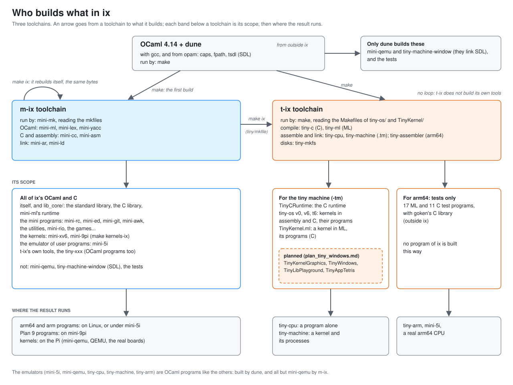

# t-ix: a programmer's manual

t-ix is the tiny half of ix (`tiny/`): a machine of our own design,
its assembler, a C and an ML compiler for it, and kernels that run on
it. This manual is the reference for someone writing a program or a
kernel for that machine: its registers, its devices and their
addresses, how a program is built and where it is loaded. It gathers what the
programs' headers say (`TinyMachineCPU.ml`'s, `TinyMachine.ml`'s,
`TinyKernel.ml`'s): they are the first source, and where this manual
and a header differ, the header is right. Each
program's header says how it works and why
([`tiny/README.md`](../../tiny/README.md) lists them); the plans say
how each was decided ([plan_tiny_os.md](../plans/plan_tiny_os.md),
[plan_tiny_windows.md](../plans/done/plan_tiny_windows.md),
[notes_tiny_kernel.md](../notes_tiny_kernel.md)).

The other tiny programs (tiny-build, tiny-shell, tiny-editor, tiny-db,
tiny-vcs) and the arm64 side (tiny-assembler, tiny-arm) run
on the host or on a real architecture and are not covered here.

## 1. The quick way

    ./tiny-machine tiny-kernel    # TinyKernel.ml, a kernel in ML: a shell on the console
    ./tiny-machine -window tiny-kernel    # and its screen in a window: paint draws there
    ./tiny-machine t6             # t6, a step before it: a kernel in C, with its disk
    ./tiny-machine v0             # v0, the first step: a page of assembly and four programs
    ./tiny-machine kernel.tm a.tm # a kernel of yours, and its programs

`-l` prints the kernel's listing instead of running it, `-n` skips the
build, `-w` keeps t6's writes to its disk. Ctrl-D ends the
shell and the machine, Ctrl-\ quits at once, Ctrl-C goes to the kernel.

The script builds the tools with dune and calls them. By hand:

| tool | what it does |
|---|---|
| `tiny-cpu f.tm...` | assembles, links and runs a program alone, the host answering its three system calls |
| `tiny-machine k.tm p.tm...` | the same with the machine around the CPU: the first file is the kernel |
| `tiny-c -tm -o f.tm f.c` | C to the machine's assembly |
| `tiny-ml -tm -o f.tm f.ml` | ML to the machine's assembly |
| `tiny-mkfs` | t6's disk image (`tiny/TinyKernel/steps/t6/TinyMkfs.ml`) |
| `tiny-prof p -k k.tm... -u p.tm...` | where the instructions went, by function, from a profile written by `tiny-cpu -prof p` or `tiny-machine -prof p` (`tiny/TinyProfiler.ml`; its `.mli` shows how it found what made `www`'s scrolling slow) |

`tiny-cpu -h` and `tiny-machine -h` show each option on an example.

## 2. How t-ix is put together

The picture is all of ix's: t-ix is its right half. The rest of this
section is that half in words.

### 2.1 Two worlds

A tiny program is either the host's or the tiny machine's.

    the host (OCaml, built by dune or by ix's own tools)
      tiny-c, tiny-ml          compilers: C and ML to .tm assembly
      tiny-cpu, tiny-machine   the assembler, the linker and the machine
      tiny-mkfs                disk images
      tiny-machine-window      the screen in a window (SDL)
            |
            |  .tm files, linked to an image
            v
    the tiny machine (assembly, C and ML, built by the programs above)
      TinyCRuntime/              the C runtime
      TinyKernel.ml            a kernel in ML, and its programs
      TinyKernel/steps/v0, t6  the steps before it, in assembly and C
      TinyMLRuntime/core.c            the ML runtime, in C

`TinyKernel.ml` is in `tiny/` beside the host's programs but is not
one of them: OCaml never compiles it, tiny-ml does.

### 2.2 What a host program needs outside `tiny/`

Each is one file, but not all stand alone. From `tiny/dune` (and
`tiny/TinyKernel/steps/t6/dune`, tiny-mkfs's):

| program | outside `tiny/` |
|---|---|
| tiny-c, tiny-ml | nothing: OCaml's standard library only |
| tiny-editor | `unix` |
| tiny-db | `unix`, `caps` |
| tiny-cpu, tiny-arm, tiny-assembler, tiny-mkfs | `lib_core/`, `fpath`, `caps` |
| tiny-machine, tiny-build, tiny-shell, tiny-utils | `lib_core/`, `fpath`, `caps`, `unix` |
| tiny-vcs | the same, and `lib_crypto/` (SHA-1), `lib_compression/` (zlib) |
| tiny-machine-window | SDL by `tsdl` (`TinyMachine/TinyMachineSDL.ml`; mini-qemu has its own, `raspberry/video/Sdl_display.ml`) |
| tiny-machine-fetch | `lib_networking/` (DNS, TLS 1.3, HTTP), `lib_graphics/images/` (PNG, JPEG, GIF), `lib_compression/`, `lib_crypto/` |

Inside `tiny/`, two libraries are shared: `TinyMachineCPU.ml` (tiny-cpu
and tiny-machine) and `TinyMachineDevices.ml` (tiny-machine's machine without a host: the
terminal's program, `TinyMachine.ml`, and a web page's,
`TinyMachineWeb.ml`, built by OCaml and js_of_ocaml only:
`./tiny-machine -web dir tiny-kernel` makes the page's directory).

What they take from `lib_core/` is its `commons/`: `FS` (a file read
or written whole), `Console` (printing), `Procs` (children and
pipes). `caps` gives the capabilities each `main` takes (`Cap.stdin`,
`Cap.open_in`...), `fpath` the paths.

### 2.3 Two ways to build the host's programs

- **By dune** (`make`, or `dune build`): OCaml 4.14 with its standard
  library, and `caps`, `fpath` and `tsdl` from opam. The executables
  are `_build/default/tiny/TinyXxx.exe`, installed as `tiny-xxx`.
- **By ix's own tools** (`tiny/mkfile`, read by mini-mk): mini-ml
  compiles each file and mini-ld links it, with ix's standard library
  (`lib_core/`, where `Cap`, `Fpath` and `Unix` are ix's own). No C
  library is linked. All the programs of 2.2 are built so, but
  tiny-machine-window.

So a tiny program is written in what both accept, and ix's library
is the smaller one: it has no `Scanf`, for example, and its
`Option.value` takes no label.

### 2.4 How the tiny machine's programs are built

By Makefiles that call the host's tools, taken from the `PATH` or
from ix's `bin/`:

| Makefile | what it builds |
|---|---|
| `tiny/TinyKernel/steps/Makefile` | `libc.tm` (from `tiny/TinyCRuntime/`), `hello`, then each step |
| `tiny/TinyKernel/steps/t6/` | `kernel.img`, the user programs, `fs.img` (tiny-mkfs) |
| `tiny/TinyKernel/Makefile` | `kernel.img`, the user programs, `boot.img` |

Each writes what it builds in a `_make/` of its own directory, and
nowhere else (as dune's `_build/` and mini-mk's `_mk/`): the
directories show the sources, `make clean` removes `_make/`.

The steps are always the same three:

    tiny-c -tm -o x.tm x.c          # or tiny-ml -tm, for ML
    tiny-machine -o kernel.img entry.tm ... x.tm     # a kernel: linked at 0
    tiny-cpu -o prog start.tm udivmod.tm libc.tm prog.tm   # a program

TinyKernel.ml has no disk: `boot.img` is `kernel.img` followed by
its files, each a name, a size and its bytes, which the kernel reads
at its start. A line `link utils` in place of the size makes a hard
link instead, as the `link` call does: the name is given the same file
as `utils`, with no bytes of its own. That is how one program, `utils`
(`tiny/TinyUtilities.ml`, by tiny-ml), is `cat`, `ls`, `wc` and the 18
other utilities. At the prompt, `ln` makes one the same way.

### 2.5 What runs what

    ./tiny-machine tiny-kernel
      -> dune builds the host's tools
      -> make -C tiny/TinyKernel                (tiny-ml, tiny-c, tiny-cpu, tiny-machine -o)
      -> tiny-machine tiny/TinyKernel/_make/boot.img
           the kernel at 0, in supervisor mode
           -> /sh in a partition, in user mode
                -> the programs it runs, each a process

## 3. The CPU (`TinyMachineCPU.ml`)

- **16 registers of 32 bits**, `r0` to `r15`. `r0` is always 0. By
  convention `sp` is `r14` and `lr` is `r15`.
- **No flags.** A branch compares two registers; `slt` makes a
  comparison a value.
- **One format**, 4 bytes an instruction: an 8-bit opcode, two 4-bit
  registers `d` and `a`, a 16-bit immediate whose low 4 bits name the
  third register.

| instructions | meaning |
|---|---|
| `add sub mul div rem and or xor shl shr sar slt sltu` | `d = a op b` |
| `addi andi ori xori shli shri sari slti sltiu` | `d = a op imm` |
| `lui` | `d = imm << 16` |
| `ldw ldb stw stb` | `d, imm(a)`: a word or a byte loaded or stored |
| `beq bne blt bge bltu bgeu` | `d, a, label` |
| `jal jalr` | a jump, `d = pc + 4` |
| `sys n` | a system call, its number `n` |

The assembler adds `li`, `la`, `mov`, `call`, `ret`, `j` and `nop`,
and the directives `.word`, `.byte`, `.ascii`, `.asciz`, `.space` and
`.align`. A comment starts with `;`.

Every case is defined: a division by 0 gives -1, a shift takes its
amount modulo 32, an address is taken modulo the memory's size, and a
word's two low address bits are ignored.

**Why `-16(r0)` is a device.** Since `r0` is 0 and addresses wrap, a
negative offset from `r0` is an address counted down from the top of
memory. The devices are there (section 5), so any instruction reaches
one without setting up a register: `stb r3, -16(r0)` prints a byte.

## 4. The machine (`TinyMachine.ml`)

The CPU with what a kernel needs. 128 MB of memory (16 MB until
2026-10-15). It starts at
address 0 in supervisor mode, with `sp` just below the devices.

### 4.1 Modes and traps

Two modes, supervisor and user. One way in: a trap saves the pc in
`epc`, the reason in `cause`, a detail in `tval`, enters supervisor
mode with interrupts off, and jumps to `tvec`. One way out: `eret`.

| `cause` | reason | `tval` | `epc` |
|---:|---|---|---|
| 1 | `sys n` | `n` | after the `sys` |
| 2 | an illegal instruction | the word | on it |
| 3 | a fault (an address not allowed) | the address | on the instruction |
| 4 | an interrupt | its sources, a bit each | on the instruction not yet run |

### 4.2 The registers of control

Read by `csrr d, name`, written by `csrw name, a`, both at once by
`csrrw d, name, a`. All three, and `eret`, are illegal in user mode.

| name | what |
|---|---|
| `status` | bit 1 supervisor mode, 2 interrupts on, 4 and 8 those two as they were before the trap, 16 the window relocates |
| `epc`, `cause`, `tval`, `tvec` | the trap's (above) |
| `time` | the instructions run so far (read only) |
| `timecmp` | the timer interrupts when `time` reaches it |
| `base`, `bound` | the window (4.4) |
| `satp` | the pages' root; its top bit turns pages on (4.4) |
| `ip`, `ie` | the interrupts pending (read only) and enabled, a bit a source |
| `hartid` | the core's number, 0 (read only) |
| `scratch` | a word for the kernel |
| `rate` | the machine's speed, in instructions per second (read only) |

The time is the count of instructions, not the host's clock, so the
same image with the same input runs the same every time. The `rate`
register says how many of those instructions make a second: 8 million
by default, or what `tiny-machine -rate n` asks for. A kernel reads it
to turn instructions into seconds.

One more instruction, legal in both modes: `amoswap d, a, (b)`, the
word at the address in `b` swapped with `a` in one step, for a lock.

### 4.3 Interrupts

An interrupt is taken when `status` has interrupts on and a source is
both pending and enabled. `tval` then holds the sources.

| bit | source | pending until |
|---:|---|---|
| 1 | the timer | `timecmp` is moved past `time` |
| 2 | the console's input | its bytes are read |
| 4 | the disk | its status word is written |
| 8 | the mouse | its word is read |

Only the timer is enabled at the start.

### 4.4 Protection: a window, or pages

In user mode, with pages off, an address must be inside the window.

- **Plain** (v0): `base <= address < bound`. A program is assembled
  where it runs.
- **Relocating** (`status` bit 16; t6, TinyKernel.ml): the address
  must be below `bound`, and `base` is added to it. Every program is
  assembled at 0.

With `satp`'s top bit set (no kernel of ix does since v6 was removed; `tiny/tests/TinyMachine_tests/paging.tm` does), addresses go through two-level page
tables instead, RISC-V's Sv32: 10 bits of index in the root table, 10
in the next, 12 in a 4 KB page. An entry's flag bits are 1 valid, 2
read, 4 write, 8 execute, 16 user. Supervisor mode reaches every
valid page.

## 5. The devices

Twelve words at the top of memory, outside any window, so only a
kernel reaches them.

| address | | device |
|---|---|---|
| `-48(r0)` | `0x7ffffd0` | the network (5.5): a memory address |
| `-44(r0)` | `0x7ffffd4` | the network: a length; read, the length of the packet that waits, 0 if none |
| `-40(r0)` | `0x7ffffd8` | the network: the command, 1 send, 2 receive |
| `-36(r0)` | `0x7ffffdc` | the network: reads 1 when there is a wire |
| `-32(r0)` | `0x7ffffe0` | the disk: a block's number |
| `-28(r0)` | `0x7ffffe4` | the disk: a memory address |
| `-24(r0)` | `0x7ffffe8` | the disk: the command, 1 read the block into memory, 2 write it from memory |
| `-20(r0)` | `0x7ffffec` | the disk: reads 1 when a transfer is done; a write ends its interrupt |
| `-16(r0)` | `0x7fffff0` | the console's output: a byte stored is printed |
| `-12(r0)` | `0x7fffff4` | the halt: the value stored is the machine's exit status |
| `-8(r0)` | `0x7fffff8` | the console's input: the next byte; `0xffffffff` none yet, `0xfffffffe` the input's end |
| `-4(r0)` | `0x7fffffc` | the mouse (5.2) |

The disk is a file given by `-d`, in blocks of 1 KB. A transfer is
done at once, and the file is written back when the machine halts.

### 5.1 The screen

640 by 480 pixels, one byte each, row after row from `0xf00000`. It
is memory like any other: `stb` stores a pixel, and a kernel that has
no use for a screen may use that megabyte as memory.

A byte is a colour in Plan 9's table of 256 (its `m8` pixels): 0 is
black, 255 white, `0xf0` red, `0x36` blue, `0xaa` a grey.

    tiny-machine -window kernel.img          # the screen in a window of the host's
    tiny-machine -screen out.ppm kernel.img  # the screen written at the halt, a PPM

### 5.2 The mouse and the keys

The mouse is one word: x in bits 0 to 11, y in bits 12 to 23, the
buttons from bit 24 (1 left, 2 middle, 4 right). Its interrupt is
pending from a change until the word is read.

The keys have no register of their own: they are the console's input,
`-8(r0)`. Without a window they come from the terminal or a pipe.
With `-window` they are typed in the window; the arrows are the bytes
128 to 131 (up, down, left, right).

### 5.3 A session replayed: `-events`

    tiny-machine -events session.txt -screen out.ppm kernel.img

The mouse and the keys come from a file, a line an event, each with
the time (in instructions) it happens at:

    2000000 m 50 50 0        the mouse at 50, 50, no button
    2100000 m 300 150 1      there, the left button down
    2300000 k ls\n           these keys typed

In a `k` line, `\n` is a new line and `\` with three digits a byte
(`\003`). The input ends after the last event. As the time is the
instructions counted, the screen at the halt is the same on every
run: this is how a program with a mouse is tested
(`tiny/tests/TinyMachine_tests/screen.tm`).

### 5.4 The window is another program

`tiny-machine -window` runs `tiny-machine-window`
(`TinyMachineWindow.ml`) as a child. It sends it the screen, a PPM
each time it changed, about thirty times a second, and reads back
event lines, section 5.3's without their times; a step of the mouse's
wheel (or of two fingers on a trackpad) comes as an arrow key, up or
down. When a program changes the mouse's look (it writes the mouse's
word: 0 the arrow, 1 a hand, as `www` does over a link), it sends the
line `C n` between two pictures. tiny-machine itself links no C
library, so ix's own tools build it; the window is the one tiny
program that needs SDL, by `TinyMachineSDL.ml`.

### 5.5 The network

A wire with two ends, the machine at one
([plan_tiny_network.md](../plans/done/plan_tiny_network.md)); tiny-kernel
uses it (`ping`, `get`, and `dial` among its calls). A packet is at most 2,048 bytes.

- **To send**: the packet's address at `-48(r0)`, its length at
  `-44(r0)`, then 1 at `-40(r0)`.
- **To receive**: the network's interrupt (source 16) is pending
  while a packet waits; `-44(r0)` reads its length. A buffer's address
  and size written as for a send, then 2 at `-40(r0)`: the packet is
  copied (no more than the size) and the next one waits.
- At most 64 packets wait; one more is lost.

What is at the other end is the host's choice:

    tiny-machine -net dir kernel.img         # tiny-machine itself, at 10.0.0.1 (the machine is 10.0.0.2)
    tiny-machine -net dir -net-trace kernel.img   # and each packet said on the standard error
    tiny-machine -net dir -net-lose 3 kernel.img  # and its third packet is lost
    tiny-machine -net dir -net-pcap f kernel.img  # and the packets written in f at the halt (tcpdump -r f, Wireshark)
    tiny-machine -net dir -net-out kernel.img     # and it is the way to other machines
    tiny-machine -net dir -net-forward 8080:80 kernel.img   # and the host's port 8080 is the machine's port 80
    tiny-machine -net-loop 100 kernel.img    # the wire itself: each packet sent comes back 100 instructions later

With `-net` the other end is `TinyKernelNetwork.ml`, the file tiny-kernel
has for its own stack, run by the host (`TinyMachinePeer.ml`). A packet
of its lands 5 ms of the machine's time (40,000 instructions at 8
million a second) after
it was sent. It answers a ping; and on port 70, over IL, it reads a
line, a name, and sends `dir`'s file of that name (no path), in
messages of 1,024 bytes, then closes: `get hello.txt` in tiny-kernel,
with `tiny/tests/www` as `dir`. The other way, `put file [name]` sends
a line `put name size` then the file's bytes, and the peer writes them
into `dir` and answers `ok`: tiny-kernel's files are in its memory and
go with the machine, what is put stays. An empty line (`get ''`,
Gopher's menu) lists `dir`, so a new boot brings it all back with
``for(f in `{get ''}) get $f > $f``. The web page keeps what is put in
the browser's `localStorage`. A line that starts with `wiki` names
a picture kept there with its text (`wiki mandelbrot`:
`mandelbrot.wiki`, a line `320 240`, the pixels a byte each in the
screen's colours, the text; `tiny/tests/TinyKernelNetwork_tests/wiki_picture.py`
makes it): the text is sent, then the picture a row a message, and
`wiki` paints each row as it arrives, on the screen or in its window
of tiny-windows; about 7 seconds of the machine's time for 240 rows on
the screen, 16 in a window. A trace's line is the machine's time,
the direction (`>` from the machine, `<` to it, `x` to it and lost)
and the packet:

        856.2 ms  > echo? 1, 4 bytes, from 10.0.0.2 to 10.0.0.1
        856.2 ms  < echo! 1, 4 bytes, from 10.0.0.1 to 10.0.0.2

A line that starts with `www` asks for a web page, for tiny-kernel's
browser (`docs/plans/done/plan_tiny_browser.md`). The other end sends the
page's bytes as the site sent them, then closes. The rest of the line
is an address: a bare title such as `OCaml` or `Plan 9 from Bell Labs`
is an English Wikipedia article, and an article's address is changed
to its REST HTML (the article without the site's menus;
`TinyMachinePeer.www_address`). With `-net-out` the page is fetched by
`tiny-machine-fetch` (`TinyMachineFetch.ml`), a program apart that links
ix's own TLS and HTTP, as `tiny-machine-socket` links the sockets.
Without `-net-out`, or when the fetch fails, a kept copy of a Wikipedia
article in `dir` answers (`tiny/tests/www/OCaml.html`); otherwise the
answer is one line that starts with `www:` and says why. In
tiny-kernel, `rc`, then `get 'www OCaml' | wc`, shows the page's 257,035
bytes. A line `img w h address` asks for a picture of a page: the
answer is `wiki`'s (a line `0 w h`, then a row of pixels a message),
the picture decoded and made w by h in the screen's colours by
`tiny-machine-fetch -picture`, from the address with `-net-out`, or
from a kept copy in `dir` named by the address's last part.

**On Linux**, the machine meets programs that are not ours, with no
root. With `-net-out` the other end is a gateway: a connection
tiny-kernel asks for to any other address is made by the host, over
TCP, and the messages pass both ways (a message to the world is its
bytes; the bytes from the world are cut in messages where they
happened to arrive). Its port 53 answers a name by its address, so a
host may be a name: `get / gopher.floodgap.com` is Gopher, and
`get / example.com 80` is the web as it was in 1996 (no https). With
`-net-forward 8080:80` a connection to the host's port 8080 is one to
the machine's port 80: `httpd` in tiny-kernel, then
`http://localhost:8080/` in a browser, is a page that lists
tiny-kernel's files, each a link. The host's sockets are in a program
apart, `tiny-machine-socket` (`TinyMachineSocket.ml`), run once for
each connection with two pipes, as the window is:
tiny-machine itself has none. `./tiny-machine tiny-kernel` gives all
three.

In the page (`TinyMachineWeb.ml`) the other end is the same, its
documents the page's: a name is a file of `www/` beside the image, and
`wiki words` asks Wikipedia (a search, the first article's sentences
and its picture, which the browser reads and the page reduces to the
screen's colours); `www` fetches the page itself (Wikipedia allows it;
a site that does not allow other pages to fetch it cannot be reached
from the page), or a kept copy beside the page; the wire is drawn under the console, a dot a
packet, and a button loses the next one. `./tiny-machine tiny-kernel`
in a terminal gives the machine its wire with `tiny/tests/www`.

A trace's line has, of IL's, its kind, its number, the last number its sender
received, its message's length (`TinyKernelNetwork.mli` has a conversation
with a packet lost):

       1325.4 ms  < data id 5001 ack 1001, 1024 bytes, from 10.0.0.1 to 10.0.0.2

A packet arrives at a time counted in instructions, so a run with
the network is the same every time
(`tiny/tests/TinyMachine_tests/net.tm`). Without a wire `-36(r0)`
reads 0, a send is lost and nothing arrives.

## 6. Programs

### 6.1 The link, and an image

There is no object file. The `.tm` files given are assembled one
after the other, their labels in one namespace, the first at address
0, where the machine starts. `-o` writes the result, an image: the
memory's first bytes, with no header.

### 6.2 C: `tiny-c -tm`

The arguments are on the stack, at `0(sp)`, `4(sp)` and so on; the
result is in `r13`; the callee may change any register but `sp`.

A program is linked after its runtime (`tiny/TinyCRuntime/`):

    tiny-c -tm -o prog.tm prog.c
    tiny-cpu -o prog start.tm udivmod.tm libc.tm prog.tm
    tiny-cpu ./prog one two

`start.tm` calls `main` and exits with its result. `libc.h` declares
`write`, `exits`, `print`, `sprint`, `malloc`, `free`, `strlen`,
`strcpy`, `strcmp`, `memset` and `atoi`.

### 6.3 ML: `tiny-ml -tm`

One file, no modules. Integers are 31 bits (a value is `2n+1` or a
pointer), so a constant beyond them is refused. The runtime is
`TinyMLRuntime/core.c`, compiled by `tiny-c -tm`, with a `main` that gives
it its memory. A C or assembly function is called as an `external`,
with C's convention and ML's values.

### 6.4 A system call

`sys n` with the arguments in `r1` to `r3` and the answer in `r1`.
What the numbers mean is up to who answers:

- under tiny-cpu, the host: 0 exit, 1 write, 2 read;
- under tiny-machine, the kernel that the trap enters (section 7).

## 7. The kernels

| kernel | language | protection | files |
|---|---|---|---|
| v0 (`tiny/TinyKernel/steps/v0/`) | assembly | a plain window | none |
| t6 (`tiny/TinyKernel/steps/t6/`) | C | a relocating window | on a disk, a FAT |
| TinyKernel.ml (`tiny/TinyKernel.ml`) | ML | a relocating window | ML values in memory |

### 7.1 TinyKernel.ml's memory

| addresses | what |
|---|---|
| from 0 | the kernel's image, then the files it carries |
| `0x480000` | the ML runtime's stack of values (the image and its files, 4.5 MB at most, end below it) |
| `0x4c0000` | the processes' frames: 17 words each, their registers and pc |
| `0x500000` to `0x700000` | the ML heap, two halves of 1 MB |
| `0x700000` to `0xd00000` | unused |
| `0xd00000` to `0xf00000` | the images a program made (`TinyKernelGraphics.ml`'s free blocks) |
| `0xf00000` | the screen, 640 by 480 bytes; then images again |
| `0x4f0000` | a packet's place, on its way to or from the network's device |
| `0x1000000` to `0x7ff0000` | the processes' partitions, found first-fit when a program starts |
| the last 48 bytes | the devices, which the kernel reaches by negative addresses (-16 is the console) |

A process sees its partition as addresses from 0 to its size: its
program is loaded at 0, its stack starts at the top. The size is 1 MB,
unless the program is an a.out (`tiny-cpu -a n`) whose header asks for
n MB: its three words are a magic number (`0x7a0ce5`), the image's size
and the memory wanted. A child of `fork` gets its parent's size. An ML
program's heap grows up to what its partition leaves (`libml/mlsys.c`);
`bigmem`, a test, keeps 3 MB alive in 8 MB.

### 7.2 TinyKernel.ml's system calls

| n | call | n | call |
|---:|---|---:|---|
| 0 | `exit(status)` | 8 | `close(fd)` |
| 1 | `write(fd, buf, n)` | 9 | `pipe(fds)` |
| 2 | `read(fd, buf, n)` | 10 | `dup(fd)` |
| 3 | `fork()` | 11 | `mkdir(path)` |
| 4 | `exec(path, argv)` | 12 | `unlink(path)` |
| 5 | `wait(&status)` | 13 | `chdir(path)` |
| 6 | `getpid()` | 14 | `kill(pid)` |
| 7 | `open(path, mode)` | 15 | `ready(fds, n, until)` |
| 17 | `box(fds)` | 16 | `ticks()` |
| 18 | `dial(address, port)` | 19 | `listen(port)` |
| 20 | `getcwd(buf, n)` | 21 | `link(old, new)` |
| 22 | `rawcons(on)` | | |

`rawcons(1)` gives the console's ^C to the calling process as a byte
it reads, while it lives, instead of killing every process but the
first: emacs's C-x C-c (Plan 9's `rawon`). `rawcons(0)` gives it back.

`dial` gives a descriptor on a connection to another machine, by its
address as text (`"10.0.0.1"`: the wire's other end) and a port; -1
without a network, or when nothing listens there or nothing answers
(six tries, 6.3 seconds). The connection is IL's (`TinyKernelNetwork.mli`):
a write is a message, 1,024 bytes at most, which arrives once and in
order, the write waiting when 20 are not yet read at the other end; a read
gives one message, whole (what is over the buffer is lost), and 0
when the other end is done; the last descriptor's close says the end,
after what was written has arrived. `get` is these three calls.
`listen(port)` is the other side: it waits for the next connection
another machine makes to that port of this one and gives its
descriptor; a server is that call in a loop (`httpd`). Port
0 is the echo and not IL: a write is a question sent there, a read an
answer's bytes; `ready` waits for one with a limit, as `ping` does
(three questions, each waited for a second).

A call that fails answers -1. Its C programs are in
`tiny/TinyKernel/user/`; what they are linked with, `user.h` and
`sys.tm`, is in `tiny/TinyKernel/libc/`, and an ML program's side of
the kernel in `tiny/TinyKernel/libml/`.

`ready` answers the first of `n` descriptors that a read would not
wait on, or -1 when the clock reaches `until` (0: no limit; with no
descriptor it is a sleep). `ticks` is the clock: the timer's
interrupts since the boot, one every 2.5 ms of the machine's time
(the `rate` register divided by 400: 20,000 instructions at 8 million
a second). `box` makes
a box, a pipe that keeps only what was last written: `fds[0]` reads it
(a read waits for a write since the last read), `fds[1]` writes it and
never waits. A process has 32 descriptors.

### 7.3 TinyKernel.ml's screen and mouse

The kernel has the pixels (`tiny/TinyKernel/TinyKernelGraphics.ml`, compiled with it);
a program says what to draw. **A program is given five descriptors**:
0, 1 and 2 its text, 3 where it draws (messages, below), 4 its mouse (a
box: a read gives x, y and the buttons, a word each, when they
changed). The first shell's are the console, the screen and the
machine's mouse, and its programs inherit them; a window system gives
a window's shell pipes and a box instead (7.4), so a program does not
know which it has. The same three as files of the root, for a program
that wants the screen itself:

| file | a read | a write |
|---|---|---|
| `/console` | the keys typed, as they come | the terminal |
| `/draw` | | messages, whole; a bad one is said on the console and the write answers -1 |
| `/mouse` | waits until the mouse changed, then 12 bytes: x, y, the buttons (1 left, 2 middle, 4 right), a word each | |

A connection (descriptor 3, or an open of `/draw`) has its images by
numbers of the program's, 0 the one it was given, freed when its last
descriptor is closed. A
message is a letter, then numbers of 16 bits, the low byte first,
signed:

| message | what |
|---|---|
| `a id x0 y0 x1 y1 repl colour` | an image made, of that rectangle, filled with a colour's byte (the one that had this number is freed); `repl` 1: it repeats (a colour is an image of one pixel that does) |
| `f id` | freed |
| `d dst src mask x0 y0 x1 y1 px py` | draw: `dst`'s rectangle is `src`'s pixels from (px, py) on, where `mask`'s are not 0 (-1: no mask) |
| `l dst src x0 y0 x1 y1` | a line, both ends drawn |
| `s dst src x y n`, then `n` bytes | a text, its top left corner at (x, y); a character is 8 by 16 |
| `p dst x y n`, then `n` bytes | a row of pixels, a byte each, its left end at (x, y): how a picture that comes from elsewhere is drawn (`wiki`) |

A colour's byte is an index of Plan 9's table of 256 (0 black, 255
white). For C, `libc/draw.h` and `draw.c` gather the messages
(`d_fill`, `d_text`, `d_flush`...); `user/paint.c` is a program of a
page that waits for the mouse, the keys and the clock at once. For ML,
`tiny/TinyLibDraw.ml` makes them.

    ./tiny-machine -window tiny-kernel
    $ paint

### 7.4 tiny-windows

`tiny/TinyWindows.ml`, a program of TinyKernel.ml's in ML (compiled by
tiny-ml -tm after `TinyLibDraw.ml`; `libml/mlsys.c` is an ML program's
runtime and system calls), is the window system:

    ./tiny-machine -window tiny-kernel
    $ windows

| the mouse | what |
|---|---|
| the right button | the menu: New, Move, Delete, Exit; let go on an item |
| then the left button | New: a rectangle swept, a shell in it; Move: a window dragged; Delete: a window pointed at |
| the left button on a window | it comes to the front, and has the keys |

A window is a text until a program draws in it: what is printed is
shown and scrolled, a line typed is edited and given at the Enter,
Control-D ends the shell's input, and the window with it. When a
program draws (`paint`), the window is its picture: the keys go to it
as typed and the mouse in the window is its mouse, until something is
printed again. A window's program is given three pipes and a box as
its five descriptors; tiny-windows reads what it draws, changes its
images' numbers and sends the messages on, the kernel keeping every
pixel. `windows` typed in a window runs there, with windows of
its own.

### 7.5 A game: TinyLibPlayground.ml

A game is a value of `tiny/TinyLibPlayground.ml`'s type `game`: the size
of its picture, its first model from a seed (`init`), the model as
shapes (`view`), the model after a key (`key`: its byte, the arrows
128 to 131) and after a frame (`frame`: thirty a second of the
machine's time). The library has the loop and the drawing: a picture
is drawn when its shapes are others than those shown, off the window
and then on it at once.

| shape | what |
|---|---|
| `Rect (colour, width, height)` | a rectangle; a colour is a byte of the table |
| `Words (colour, text)` | a text, in the one font, 8 by 16 |
| `Group shapes` | shapes together, the first under the next |
| `Move (right, down, shape)` | a shape moved; y goes down from the top left corner |

`random s` is the next state of a generator of the model's. A game is
several files given to tiny-ml as one program (TinyKernel's
Makefile: `libml/calls.ml`, `TinyLibDraw.ml`, `TinyLibPlayground.ml`, the
game, and a last file that says `let () = run game`); the same files
are OCaml's, where a game's model and picture are tested with no
machine. `square` is one of a page
(`tiny/tests/TinyLibPlayground_tests/Square.ml`): type it at the screen's
shell or in a window; `q` quits. `tetris` is `tiny/TinyAppTetris.ml`:
the arrows move the piece (up turns it, down is a row), the space
drops it, `q` quits; after a game over, the space starts another.

### 7.6 A program with buttons: TinyLibGUI.ml

A program with widgets is a value of `tiny/TinyLibGUI.ml`'s type `gui`:
its first model (`init`), the model as widgets (`view`), the model
after a message (`update`), and the messages of a key when no field
has the keys (`key`). The library has the loop, the layout, the mouse,
the keys and the drawing: a button the mouse goes down in and comes up
in sends its message, the field last clicked in has the keys, and
only the widgets that are others than those shown are drawn.

| widget | what |
|---|---|
| `Label text` | a text |
| `Field text` | a text in a white box, at its right; not typed in |
| `Input (text, message of a text)` | a field typed in: a key sends the text with the character more, a backspace with one less; its caret is at the end |
| `Button (text, message)` | a button, and what it sends |
| `Row widgets` | side by side, the same width each |
| `Col widgets` | one under the other, the column's width each |

It is given to tiny-ml after the playground, whose shapes it draws by
(TinyKernel's Makefile: `libml/calls.ml`, `TinyLibDraw.ml`,
`TinyLibPlayground.ml`, `TinyLibGUI.ml`, the program, and a last file that
says `let () = run calculator`). `calc` is `tiny/TinyAppCalculator.ml`:
the mouse on its buttons, or the keys (the digits, `+ - * /`, `=` or
the Enter, `c` clears); `q` quits. Whole numbers of nine digits, an
operation done when the next one is asked (`2+3*4=` is 20). `temp` is
`tiny/TinyAppTemperature.ml`: click in a field and type a temperature,
the other field has it in the other scale, to the nearest whole
number; the Escape quits (or `q`, before a field is clicked).

With `-window` the machine runs at a fixed speed, 20 million
instructions a second unless `-rate n` says otherwise (n in millions),
so that a game's time is the same on every host that can keep up, and
a key held is typed again. Without a window the machine does not wait,
and its speed (8 million by default) only says how long its second is.
The kernel reads the speed, so the programs that count ticks (the games,
`ping`, IL's timers) keep their pace at any speed, while those that
compute finish sooner. The web page runs at 8 million.

## 8. Tests

| what | how |
|---|---|
| the CPU | `tiny/tests/TinyCPU_test.sh` |
| the machine, v0, the devices, the screen | `tiny/tests/TinyMachine_test.sh` |
| t6 | `make -C tiny/TinyKernel/steps/t6 check` |
| TinyKernelGraphics.ml, on the host and on the machine | `tiny/tests/TinyKernelGraphics_test.sh` (`-window`: its picture shown) |
| TinyLibPlayground.ml, a game's model and picture on the host | `tiny/tests/TinyLibPlayground_test.sh` |
| TinyAppTetris.ml, its rules by scripts of keys and its picture, on the host | `tiny/tests/TinyAppTetris_test.sh` |
| TinyLibGUI.ml, TinyAppCalculator.ml and TinyAppTemperature.ml, the arithmetic by keys, the buttons by a mouse, the fields by clicks and keys, the picture, on the host | `tiny/tests/TinyLibGUI_test.sh` |
| TinyKernel.ml; paint, tiny-windows, tiny-windows in a window, square, tetris, calc and temp in a window, each with a recorded mouse and keys | `make -C tiny/TinyKernel check` (a minute and a half) |

On macOS they need GNU's coreutils first in the `PATH` (`stat -c`,
`wc`).
