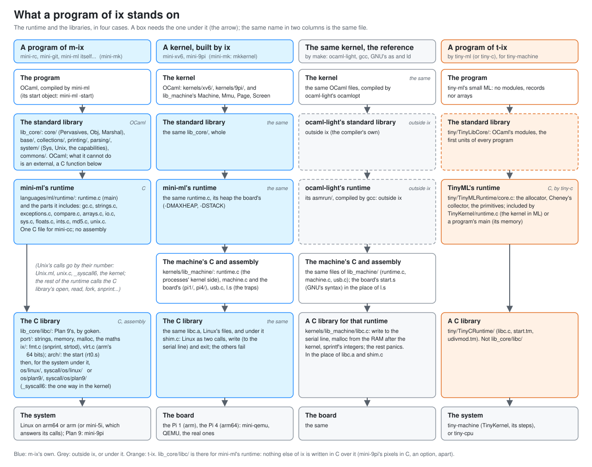
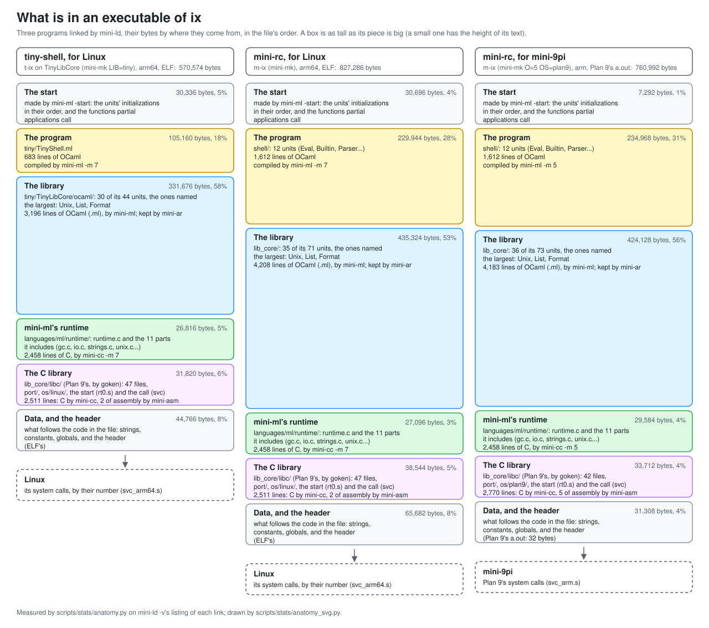

# The projects inside ix

ix is several projects in one repository, and they cross two ways: by
**size** (a faithful mini program or a free tiny one) and by
**machine** (real ARM, or a machine of our own). Most of ix is OCaml
that runs on the host; some of it is code that runs *inside* an
emulated machine, in assembly or C. This page says which is which.
Names in italics are planned.

## Who builds what

Three toolchains build ix, and each has its scope:

- **OCaml and dune**, from outside ix, build every OCaml program of
  ix the first time, and are the only ones to build mini-qemu and
  tiny-machine-window (SDL) and the tests.
- **The m-ix toolchain** (mini-mk and the mkfiles; mini-ml, mini-cc,
  mini-asm, mini-ld...) then builds all of that again, itself
  included, to the same bytes; t-ix's tools too, which are OCaml
  programs.
- **The t-ix toolchain** (tiny-c, tiny-ml, tiny-cpu, tiny-machine)
  builds what runs on the tiny machine: TinyKernel.ml, the steps
  before it (`tiny/TinyKernel/steps/`) and their programs (windows,
  tetris, office, www, emacs among them, in ML). It also builds itself:
  tiny-ml compiles the tools (`cc`, `ml`, `as`, `ld` in tiny-kernel's
  `/bin`), and tiny-kernel builds its own image, the host's byte for
  byte ([plans/done/plan_tiny_self_hosting.md](plans/done/plan_tiny_self_hosting.md);
  tiny-cpu stays the host's).

[manuals/t-ix.md](manuals/t-ix.md), section 2, has the details of the
tiny side.

## What a program stands on

A program compiled by mini-ml is not alone in its executable: under it
are the standard library, mini-ml's runtime and a C library, each
needing the next:

- **The standard library** (`lib_core/`'s OCaml: `core/`, `base/`,
  `collections/`, `printing/`, `parsing/`, `system/`, `commons/`):
  what OCaml cannot do there is an `external`, a C function of the
  runtime.
- **mini-ml's runtime** (`languages/ml/runtime/`): `runtime.c`, the one
  C file compiled, which includes its parts, a file each (`gc.c` the
  heap and its collector, `strings.c`, `exceptions.c`, `compare.c`,
  `arrays.c`, `io.c` the channels, `sys.c`, `floats.c`, `ints.c`,
  `md5.c`, `unix.c`).
- **The C library** (`lib_core/libc/`, Plan 9's by goken): there for
  the runtime, which is its one user in ix. Its files of every system,
  then Linux's or Plan 9's. `Unix`'s calls do not go through its
  functions but by their number (`unix.c`, `_syscall6`).
- **A kernel built by ix** has the same three, whole, and between the
  runtime and the C library its own C and assembly
  (`kernels/lib_machine/`); the C library finds under it not Linux but
  `shim.c`, which answers two calls.
- **The reference kernels** are those same kernels built another way,
  by the Makefiles: ocaml-light compiles the OCaml and brings its own
  standard library and runtime, gcc and GNU's `as` and `ld` do the
  rest. Two files of ix are only for them: the board's `start.s`
  (`l.s` in GNU's syntax) and `kernels/lib_machine/libc.c`, a C library
  for ocaml-light's runtime. They are what an ix-built kernel is
  compared with, and `make loc` counts them apart.
- **tiny-ml** has none of this: its standard library is
  `tiny/TinyLibCore/`, OCaml's modules as tiny programs name them, its runtime
  `tiny/TinyMLRuntime/core.c`, and the C library under it is
  tiny-c's own, `tiny/TinyCRuntime/`, not `lib_core/libc/`. The next
  picture is t-ix's side.

## What a tiny program stands on

t-ix has four kinds of program, and they do not stand on the same
things: a tool runs on the host, the others on tiny-machine.

- **A tool** (tiny-shell, tiny-c, tiny-vcs...) is OCaml in one file.
  Built by ix (`mini-mk` in `tiny/`), it is on `lib_core/` whole, as
  a program of m-ix: its standard library and `commons/`, mini-ml's
  runtime, `lib_core/libc/`. Built by dune, while developing, it is on
  OCaml's own standard library and `lib_core/commons/`.
  (old: on `tiny/TinyLibHost/`, a copy of `lib_core/` trimmed to what
  the tools name, with mini-ml's runtime cut to it and a C library of
  a page; gone with plans/done/plan_tiny_self_hosting.md's step 2.)
- **A program in ML on tiny-machine** (`windows`, `calc`, `temp`,
  `tetris`, `office`, `www`, `emacs`, `play`...) is units tiny-ml
  compiles one at a time (each file, with an interface, `.tmi`, for
  the units after it), linked: the libraries it asks for
  (`TinyLibGUI`, `TinyLibPlayground`, `TinyLibDraw`, `TinyLibRegex`...),
  its own file and its parts, and a last one that runs it, of which
  tiny-linker keeps what the program calls. Before them all come `tiny/TinyLibCore/`'s
  modules, tiny-ml's standard library. Under the ML: `TinyMLRuntime/core.c` (the
  allocator, the collector), given the program's memory by
  `TinyKernel/libml/mlsys.c`, and `TinyCRuntime/` for the start and the
  division.
- **A program in C on tiny-machine** (`sh`, `mltests`, the network's
  `ping`, `get`, `put`, `httpd`) is one file of `TinyKernel/user/`,
  with `TinyCRuntime/` (its library, its start, the division) and
  `TinyKernel/libc/` (`sys.tm`, the system calls; `draw.c`, `net.c`;
  `user.h`).
- **The kernel** is `tiny/TinyKernel.ml` and its parts in
  `TinyKernel/` (`TinyKernelProcs`, `Scheduler`, `Calls`, `Files`,
  `FS`, `Devices`, `Graphics`, `Audio`, `Network`...), on the same
  prelude and the same `core.c`, with its own assembly for the start,
  the traps and the pixels' rows.

`lib_core/` and `TinyLibCore/` are therefore one API twice, OCaml's
standard library's, the second a subset of the first: the first is
under the tools, on Linux; the second under what tiny-ml compiles, on
tiny-machine (and, after plan_tiny_self_hosting.md, under the tools
too).
`scripts/stats/tiny_layers_svg.py` draws the picture, from a table in
it.

## What is in an executable

The same layers, measured in three files: a tiny program built on
`tiny/TinyLibHost/` (`mini-mk` in `tiny/`, until
plans/done/plan_tiny_self_hosting.md's step 2, which removed it), and
mini-rc for Linux and for mini-9pi. Each byte of code is given to
the source file it comes from. The picture and the numbers after it
are of that time; tiny-shell was measured again once on `lib_core/`,
as it is built since: tiny-shell is 676,910 bytes (the
library 404,312 of them, 32 units of lib_core's; TinyLibHost's 30 were smaller):

- **The library is more than half of each file**, and on Linux `Unix`
  alone is a quarter of it (96,000 and 111,000 bytes; Plan 9's is
  61,000): each system call is written there in OCaml, the kernel's
  structures packed and read as bytes.
  Of a library mini-ld takes the units that are named (`mini-ar`
  keeps them; `mini-ml -start` names them all weakly): 30 of
  TinyLibHost's 44 for tiny-shell, 35 of lib_core's for mini-rc.
- **The runtime is whole in every program**: `runtime.c` is one
  object. **The C library nearly so**: 47 of the 48 files of
  `lib_core/mkfile`'s list for Linux are in tiny-shell (all but
  `port/mainargs.c`), since the runtime names them.
- **For mini-9pi the pieces are the same but two**: `Unix` is
  `lib_core/system/plan9/`'s, and the C library's files of the system
  are `os/plan9/`'s, with `ix/vlrt.c` (64-bit arithmetic on arm) and
  arm's division in assembly. The file is Plan 9's a.out (`mini-ld
  -H2`), the calls Plan 9's.
- **The start** is 30,000 bytes on arm64 and 7,000 on arm.

So what a tiny program needed from m-ix beside TinyLibHost's OCaml,
had it been in `tiny/TinyLibHost/c/`: the runtime (`languages/ml/runtime/`, 14
files, 2,683 lines) and the C library's 47 files (2,511 lines of C and
assembly) with the 40 headers they reach (1,421 lines): about 6,600
lines.

To measure a program, link it again with `-v` and give the listing to
[`scripts/stats/anatomy.py`](../scripts/stats/anatomy.py) (`-v`: each
unit and each C file):

    cd tiny && mini-mk && B=../_mk/7 && T=$B/tiny
    mini-ld -m 7 -H7 -nofollow -v -o /tmp/tiny-shell $T/TinyShell.start.7 $B/lib_core/lib_core.a \
      $T/TinyLibSystem.7 $T/TinyShell.7 $B/lib_core/std_exit.7 $B/lib_core/runtime.7 $B/lib_core/libc.a |
      ../scripts/stats/anatomy.py /tmp/tiny-shell -prog tiny

The file made is the one mini-mk made, byte for byte.
`scripts/stats/anatomy_svg.py` draws the picture from three such
listings. What follows the code in a file (strings, constants,
globals) is not told apart by piece.

## Two kinds of code

- **Host programs, in OCaml.** Every executable ix builds with dune
  (`make`, then `bin/`): the mini programs, the tiny programs, the
  emulators themselves. They run on Linux.
- **Guest code.** What an emulated machine runs: ARM executables for
  mini-5i and mini-qemu, from ix's own toolchain (mini-ml, mini-cc,
  mini-ld: m-ix's programs, and `kernels/`'s, which are OCaml), from
  goken's compilers, or kernels of others like xv6 and 9pi; `.tm`
  assembly, and C and ML compiled by `tiny-c` and `tiny-ml`, for
  tiny-cpu and tiny-machine (`tiny/TinyKernel.ml` and its programs,
  `tiny/TinyKernel/steps/`, the tests).

## Two sizes of host program

- **mini-xxx** (m-ix): a Plan 9 program's faithful twin, named after
  it, its output the original's byte for byte (`builder/`, `shell/`,
  `editors/`, `assembler/`, `linker/`, `languages/`, `database/`,
  `version_control/`, `utilities/`, `windows/`, `machine/`,
  `raspberry/`); and, under the same name scheme, larger programs
  that are twins of what one sees and uses, not of a source
  (`apps/`, `browsers/`, `games/`, `typesetting/`, `networking/`), and
  the systems of `kernels/`.
- **tiny-xxx** (t-ix): a free variant under `tiny/`, named after what
  it does, keeping the idea and redesigning the rest: a file
  `TinyXxx.ml`, and past ~700 lines its parts in a folder `TinyXxx/`
  (tiny-c, tiny-ml, tiny-machine, tiny-www, tiny-office, tiny-kernel).
  One of them keeps its core in a library for a second program
  (`TinyMachineCPU.ml`, tiny-cpu's, for tiny-machine).

Both share `lib_core/commons/` (files, processes, the console,
logging), `lib_crypto/` and `lib_compression/`; what each has for a
standard library depends on who builds it (the two pictures above).

## Two families of machine

Real ARM, whose guest code comes from real toolchains, and a machine
of our own, designed to teach, whose guest code ix writes itself:

|                      | CPU, user mode                        | machine, with devices, for a kernel |
|----------------------|---------------------------------------|-------------------------------------|
| real ARM, faithful   | mini-5i (`machine/`: arm32, arm64)    | mini-qemu (`raspberry/`: the Pi1, the Pi2, the Pi4; `./mini-pi`) |
| our own, free        | tiny-cpu (`TinyCPU.ml`, `TinyMachineCPU.ml`) | tiny-machine (`TinyMachine.ml`; `./tiny-machine tiny-kernel`, `t6`, `v0`) |

Each machine, with what makes its guest code and what runs on it:

| machine      | its toolchain                                     | what runs on it |
|--------------|---------------------------------------------------|-----------------|
| mini-5i      | mini-cc, mini-asm, mini-ld (goken's 5c/5l, 7c/7l the reference) | Linux and Plan 9 user programs, arm and arm64 |
| mini-qemu    | ix's own (mini-ml, mini-cc, mini-ld by mini-mk), or ocaml-light and gcc (the reference builds), or the kernels' own builds outside ix | `kernels/`'s (mini-9pi, mini-xv6, mini-oberon...); xv6 (`~/xv6`), 9pi (`~/principia`), as QEMU runs them |
| tiny-cpu     | `tiny-c`, `tiny-ml`, tiny-assembler, tiny-linker  | images: `.tm` programs; C programs with `TinyCRuntime/`, ML ones with `TinyMLRuntime/` |
| tiny-machine | the same, plus csrr, csrw, eret                   | tiny-kernel, its steps (v0, t6) and their programs |

The tiny side has no real architecture: tiny-c and tiny-ml had an
arm64 back end, with tiny-assembler and tiny-arm
(plans/done/plan_tiny_arm64.md), until
plans/done/plan_tiny_self_hosting.md left tiny-machine their one target.
The mini side has arm32 and arm64.

## The kernels

Several different projects, not versions of one (v0 and t6 are steps
before tiny-kernel, kept; how they relate to the others:
[plans/done/plan_tiny_os.md](plans/done/plan_tiny_os.md)):

| kernel | what | in | runs on |
|---|---|---|---|
| v0 (`tiny/TinyKernel/steps/v0/`) | a page of kernel: traps, a timer, round robin, protection by a window; its four programs linked with it | TinyCPU assembly | tiny-machine |
| t6 (`tiny/TinyKernel/steps/t6/`) | a free kernel in C: spawn and no fork (descriptors given, none inherited), one kernel stack and calls that rerun, a partition a process, a FAT, a lottery | C, by `tiny-c`, and a page of `.tm` | tiny-machine, its window relocating |
| TinyKernel.ml (tiny-kernel, `tiny/TinyKernel.ml` and `TinyKernel/`) | the Kernel row's free variant (README's series): fork and exec, round robin on several cores, a partition a process, a waiting call a closure the scheduler retries, no zombies; a disk with snapshots in a union with the boot image's files; a screen its programs draw on by messages, a window system (`tiny/TinyWindows.ml`, in ML), sound, a network (IL, HTTP); its programs, the toolchain among them, building the kernel again ([plans/done/plan_tiny_windows.md](plans/done/plan_tiny_windows.md)); [notes_tiny_kernel.md](notes_tiny_kernel.md) | ML, by `tiny-ml`, a page of `.tm`, 80 lines of C | tiny-machine, its window relocating |
| mini-9pi (`kernels/9pi/`) | 9pi's twin, the Kernel row's mini program (README): m-ix's programs run under it, and m-ix builds itself on its card | OCaml, with a thin C/asm shim | the Pi1, Pi2, Pi4 (mini-qemu, real boards) |
| mini-xv6 (`kernels/xv6/`) | xv6 in OCaml, one kernel on two boards, each port's own user programs and `fs.img` | OCaml | the Pi1, the Pi4 |
| mini-oberon (`kernels/oberon/`) | the Oberon system (*Project Oberon*, 2013) as one sees and uses it | OCaml | the Pi1, the Pi4 |
| mini-singularity (`kernels/singularity/`) | Singularity's processes, isolated by the language and not the MMU | OCaml | the Pi1, the Pi4 |
| mini-squeak (`kernels/squeak/`) | Squeak on the bare board, over `languages/smalltalk/` | OCaml | the Pi4 |
| *mini-dos*, *mini-l4*, *mini-xen* | planned: a survey each (`kernels/dos/` ...), [plans/plan_system_dos.md](plans/plan_system_dos.md) and its siblings | | |

One more, an idea, maybe a project of its own outside ix: *tiny-bootstrap*, principia's
"Bootstrapping from Scratch" appendix made runnable on tiny-machine: a
loader, a file system, time-sharing, then C, with the tools rebuilt on
the machine itself (plan_tiny_os.md).

xv6 and 9pi themselves are not ix's: they are guest code mini-qemu is
tested with.

## What comes from outside

- **goken** (`~/goken`): principia's Plan 9 toolchain built for Linux,
  the reference for mini-asm, mini-ld and mini-cc.
- **principia** (`~/principia`): the books' C, and 9pi with its SD
  card image.
- **xv6** (`~/xv6`): its Pi ports, booted by mini-qemu.
- **xix**: the OCaml ports of the same programs, a source of ideas,
  not of code.
